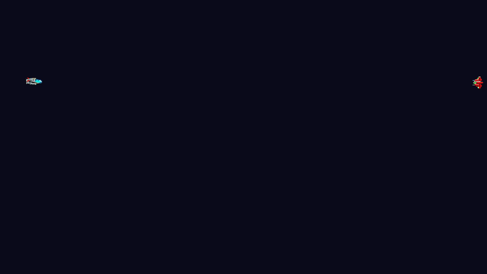

# R-Type

A networked multiplayer remake of the arcade shoot'em up R-Type, built on our own C++ game engine.
Up to 4 players connect to an authoritative UDP server and fight waves of enemies together.



**C++20 · custom ECS engine · UDP with Asio · SFML 3 · CMake + CPM · GoogleTest · GitHub Actions (Linux and Windows)**

Epitech project, team of 4.

## Highlights

- **Engine and game kept apart.** `engine/` is a generic ECS engine (entity registry on sparse arrays, systems, fixed timestep, AABB collisions, event bus, byte serialization) and contains no R-Type code.
- **Authoritative server.** Clients only send their inputs; the server runs the game and sends snapshots back over a small binary protocol ([docs/protocol.md](docs/protocol.md)).
- **Checked before merging.** A GitHub Actions workflow builds and tests on Linux and Windows and checks formatting; `scripts/check.sh` runs the same checks locally.
- **Documented.** Architecture, engine, protocol, how-to guides, decision records and an accessibility study in [docs/](docs/index.md).

## Requirements

- A C++20 compiler: GCC 12+, Clang 16+ or MSVC 2022
- CMake 3.24+
- Git (dependencies are downloaded automatically by [CPM](https://github.com/cpm-cmake/CPM.cmake))
- **Linux only**, system packages needed by SFML:
  - Fedora: `sudo dnf install libX11-devel libXrandr-devel libXcursor-devel libXi-devel mesa-libGL-devel systemd-devel`
  - Ubuntu/Debian: `sudo apt install libx11-dev libxrandr-dev libxcursor-dev libxi-dev libgl1-mesa-dev libudev-dev`

## Build

```sh
export CPM_SOURCE_CACHE=$HOME/.cache/CPM   # optional: share downloaded dependencies between builds
cmake -S . -B build
cmake --build build -j
```

The binaries `r-type_server` and `r-type_client` are created at the repository root.

Options: `-DRTYPE_BUILD_CLIENT=OFF` (server only), `-DRTYPE_BUILD_TESTS=OFF`.

## Run

```sh
./r-type_server [port]          # default port: 4242
./r-type_client [host] [port]   # default: 127.0.0.1 4242
```

Run the client from the repository root so it finds `assets/`.
Controls: arrow keys or `Z` `Q` `S` `D` to move, `Space` to shoot.

## Tests

```sh
ctest --test-dir build --output-on-failure
scripts/check.sh                 # formatting + build without warnings + tests, as the CI does
```

## Project layout

| Folder | Content |
|---|---|
| `engine/` | Generic game engine (ECS, game loop, events, collisions, serialization). Knows nothing about R-Type. |
| `common/` | Code shared by server and client: network protocol, components, constants. |
| `server/` | Authoritative game server. |
| `client/` | Graphical client (SFML). |
| `tests/` | Unit tests (GoogleTest). |
| `docs/` | Documentation, starting at [docs/index.md](docs/index.md) (also buildable as a website, see that page). |

## Contributing

See [CONTRIBUTING.md](CONTRIBUTING.md).

## Team

Kevin Huynh ([@Nivek-Hyn](https://github.com/Nivek-Hyn)), Katia Pontre, Nael Gamba, Julien Leiner.

My part: the project setup (CMake with CPM, CI on Linux and Windows, formatting checks), the engine core (entity registry, sparse arrays, fixed timestep, movement, AABB collisions, event bus), the first version of the binary protocol, server-side gameplay (enemy spawns, missile hits, score), unit tests and most of the technical documentation.
