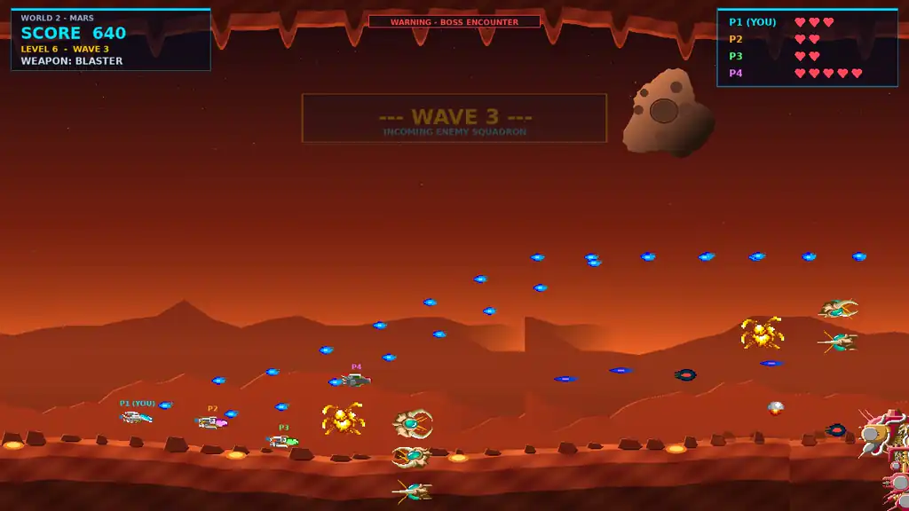
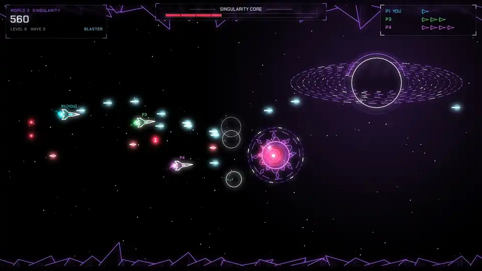
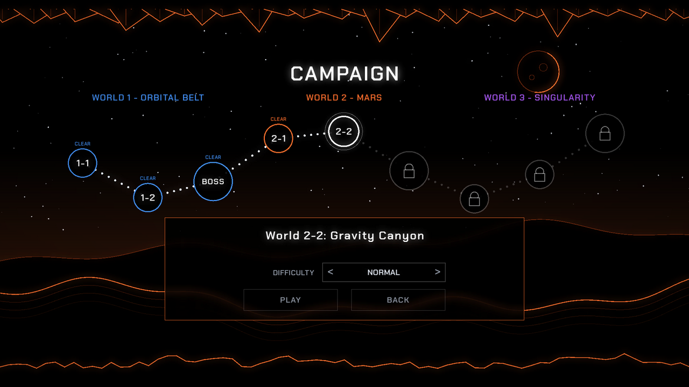
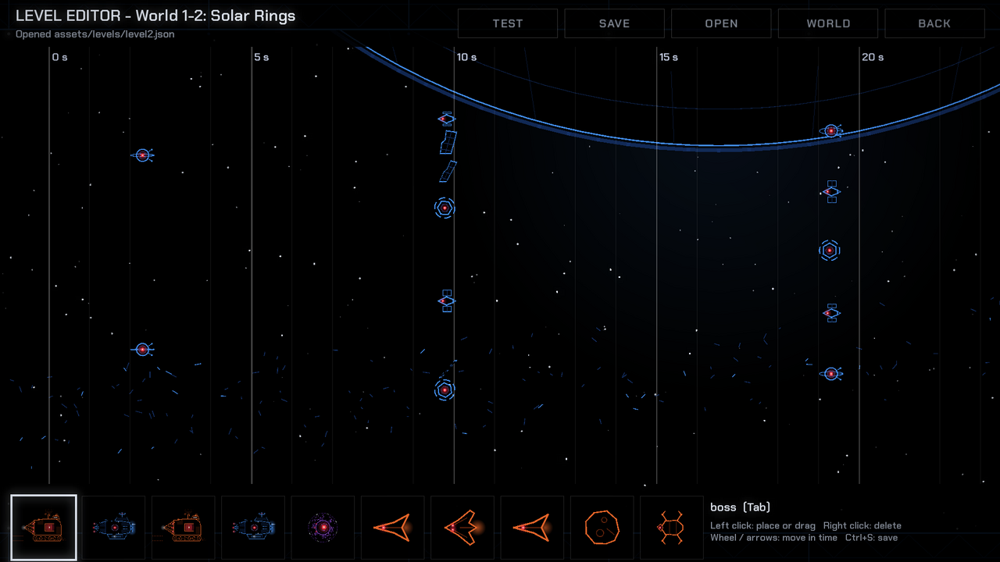

# R-Type

A multiplayer shoot'em up in C++20, built on our own reusable game engine. Up to four players join an
authoritative UDP server, alone or together, on Linux and Windows.

**C++20 · custom ECS engine · UDP with Asio · SFML 3 · JSON content · CMake + CPM · GoogleTest · CI on Linux and Windows**

Epitech project (third year), team of 4, delivered on 9 November 2026.





*Four clients connected to one server on the same machine. Each ship is steered by a small autopilot written only
for this recording (not part of the repository) that reads the client's snapshots instead of the keyboard.*

## What it does

- **Game**: a campaign of 9 levels in 3 worlds (Orbital Belt, Mars, Singularity), each world ending with a boss; an
  infinite mode with random spawns; three difficulties; weapons and bonuses; a waiting room; lives and respawns.
- **Content as data**: every entity is a prefab described by its components in
  [`assets/config/entities.json`](assets/config/entities.json), and every level is a JSON file. A level editor is built
  into the game (CREATE A LEVEL): place enemies on a timeline as they look in the game, save, and test the level at once.
- **Network**: binary protocol over UDP ([specification](docs/protocol.md)), reliable messages with acknowledgements,
  split snapshots, 16-bit positions, 30 snapshots per second with client interpolation, rate limits, live statistics
  (F3). The server is authoritative: clients only send their inputs.
- **Engine**: ECS with prefabs and entity generations, fixed timestep, event bus, AABB physics, network building
  blocks. It builds and installs on its own, and a second game (`brickrush`, a brick breaker) uses it without any
  R-Type code.
- **Accessibility**: remappable keys, auto fire (F1), high contrast (F2), shapes and letters besides colors.

| Campaign map | Level editor |
|---|---|
|  |  |

## Requirements

- A C++20 compiler (tested: GCC 13 and 15 on Linux, MSVC 2022 on Windows), CMake 3.28+ (3.24+ for a server-only build).
- Git and Internet access for the first build: [CPM](https://github.com/cpm-cmake/CPM.cmake) downloads Asio,
  SFML, nlohmann/json and GoogleTest.
- On Linux, the system libraries SFML needs:
  - Fedora: `sudo dnf install libX11-devel libXrandr-devel libXcursor-devel libXi-devel mesa-libGL-devel systemd-devel`
  - Ubuntu/Debian: `sudo apt install libx11-dev libxrandr-dev libxcursor-dev libxi-dev libgl1-mesa-dev libudev-dev`

## Build and play

Linux:

```sh
cmake -S . -B build -DCMAKE_BUILD_TYPE=Release
cmake --build build --parallel 4
./r-type_client            # menu: campaign, infinite mode, host or join a game, level editor
```

Windows (Developer PowerShell for Visual Studio 2022):

```powershell
cmake -S . -B build/windows -G "Visual Studio 17 2022" -A x64
cmake --build build/windows --config Release --parallel 4
.\Release\r-type_client.exe
```

For a LAN game, start a dedicated server with `./r-type_server 4242`, then run `./r-type_client <server address> 4242`
on each player's computer (allow the UDP port in the firewall). `./r-type_server --help` lists its options (mode,
difficulty, first level, statistics). Run the programs from the repository or installed directory, where `assets/` is.

Controls: arrows or ZQSD move, Space shoots, F1 auto fire, F2 high contrast, F3 network statistics, Escape returns to
the menu.

Options: `-DRTYPE_BUILD_CLIENT=OFF` for a server-only build, `-DRTYPE_BUILD_TESTS=OFF` to omit the tests. More in the
[build guide](docs/build-and-run.md) and the [cross-platform guide](docs/cross-platform.md).

## Checks

```sh
ctest --test-dir build --output-on-failure --no-tests=error   # 230 tests
scripts/check.sh   # formatting, build, clang-tidy and tests, as the CI does
```

The engine can also be built and installed on its own (`cmake -P engine/cmake/CheckPackage.cmake`); see
[engine/README.md](engine/README.md) and the [extension guide](docs/how-to.md).

## Project layout

| Directory | Responsibility |
|---|---|
| `engine/` | Generic ECS and prefabs, timing, events, physics, binary buffers, reliable delivery helpers; standard library only. |
| `common/` | R-Type protocol, components and constants shared between client and server. |
| `server/` | Authoritative simulation and Asio transport. |
| `client/` | SFML rendering, menus, campaign map, level editor, input and Asio transport; hosts a local server for solo games. |
| `games/brickrush/` | Second game made with the engine only. |
| `tools/level-editor/` | Reading and writing of level files, used by the editor in the client. |
| `tests/` | GoogleTest tests. |
| `docs/` | [Documentation index](docs/index.md): [architecture](docs/architecture.md), [protocol](docs/protocol.md), [technical study](docs/technical-study.md), decision records. |

See [CONTRIBUTING.md](CONTRIBUTING.md) for the workflow and [THIRD_PARTY_NOTICES.txt](THIRD_PARTY_NOTICES.txt) for
dependency notices and asset provenance.

## License

No license has been chosen: the source code is all rights reserved by its authors. Every picture of the game is drawn
in code; the Chakra Petch font is under the SIL Open Font License (see [`THIRD_PARTY_NOTICES.txt`](THIRD_PARTY_NOTICES.txt)).

## After the project

This repository is the final version from the school repository (up to 9 November 2026). Since then:

- **A new look, drawn in code.** The sprites supplied by the school and the image backgrounds are gone: ships,
  enemies, bosses and the three worlds are drawn from black shapes and lines of light, one colour per world, red only
  for what hurts. A glow pass (Settings > Visual style: Classic, Neon, Arcade) makes shots, engines and explosions
  shine; high contrast turns every effect off.
- **Bosses.** Three new animated bosses, one per world, that wear down below half health. A boss enters quickly,
  cannot be hurt before it is in place, and its health grows with the number of players; the HUD shows its name and
  a health bar (protocol version 9 carries the boss health in each snapshot).
- **Effects and interface.** Explosions with sparks, embers and smoke, engine trails in each player's colour, a hit
  flash, a chain of explosions when a boss falls; HUD, menus and level editor restyled.
- **Display fixes.** The HUD lines no longer overlap, the end screen no longer shows the connection message, and a
  new level no longer announces "wave 0".

## Team and contributions

Kevin Huynh ([@Nivek-Hyn](https://github.com/Nivek-Hyn)), Katia Pontre ([@katiaP18](https://github.com/katiaP18)),
Nael Gamba ([@nael481](https://github.com/nael481)) and Julien Leiner ([@Julien-Lnr](https://github.com/Julien-Lnr)).

- **Kevin Huynh: engine and project tooling.**
  - Project setup: CMake with CPM, CI on Linux and Windows, formatting and clang-tidy checks, installation and
    release archives with library licenses and Windows DLLs.
  - Engine: entity registry on sparse arrays, fixed timestep, movement, AABB collisions, event bus, then prefabs,
    entity generations, and a standalone build that other projects can install.
  - Content as data: entities described by their components in JSON, configurable weapons and bonuses.
  - Tools and features on top of the engine: the level editor inside the game, the second game Brick Rush, the
    campaign map that remembers the levels reached, the waiting room (with Julien), auto fire and high contrast.
  - Presentation: world backgrounds drawn from image layers with a fade between worlds, HUD panels with hearts.
  - The first version of the binary protocol and its specification, server-side gameplay of the first part (spawns,
    hits, score), unit tests and most of the technical documentation.
- **Nael Gamba: networking.** Reliable messages with acknowledgements, sequence numbers and duplicate filtering,
  split snapshots, 16-bit positions, 30 Hz snapshots with client interpolation, rate limits, network metrics and a
  lossy-link test proxy.
- **Julien Leiner: client and rendering.** The SFML client and its main menu, enemy sprites and explosions, music
  and sounds, saved settings, the local server embedded in the client for solo and hosted games, the ready status of
  the waiting room, world decors with ground and ceiling.
- **Katia Pontre: gameplay and level content.** The 9 levels in 3 worlds, new enemies and boss attacks, the infinite
  and campaign modes, lives.
