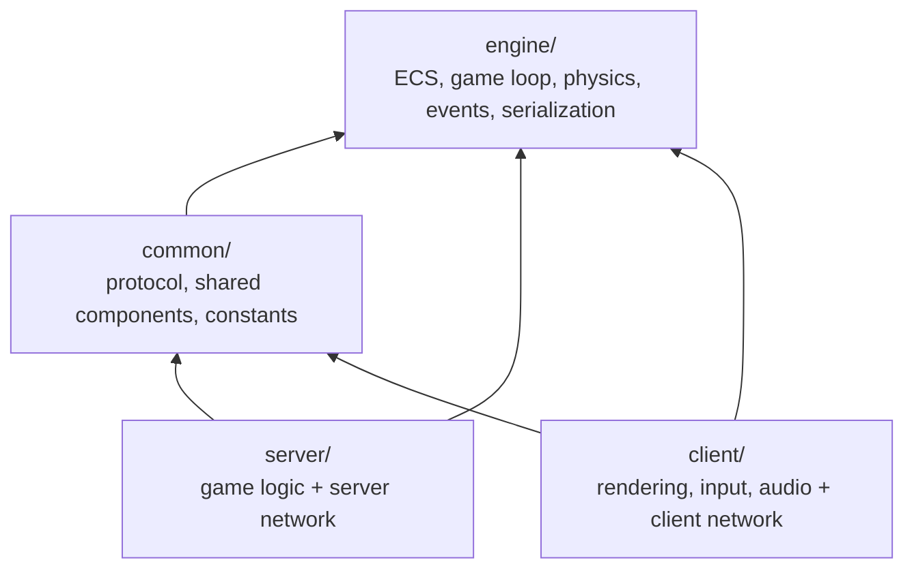
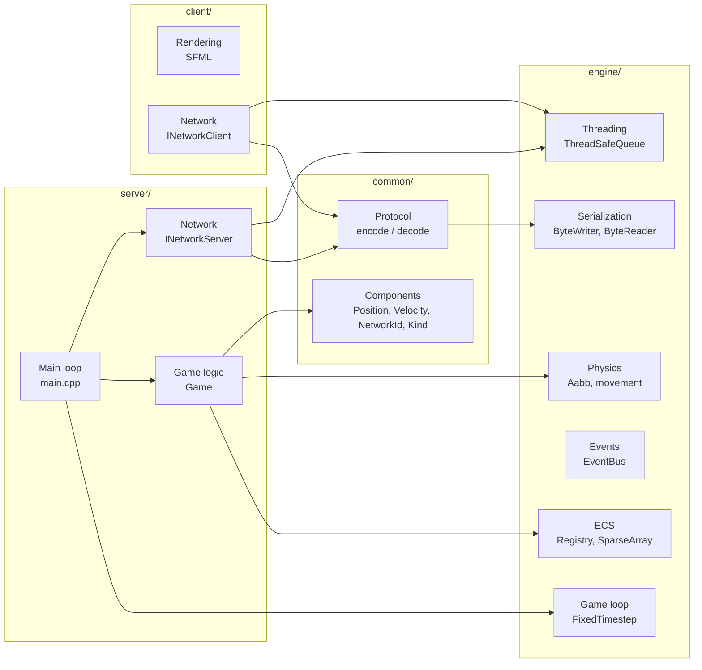
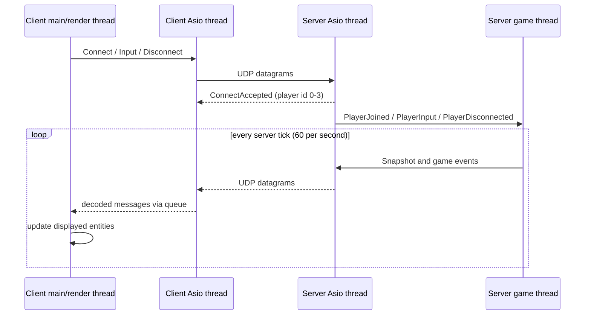
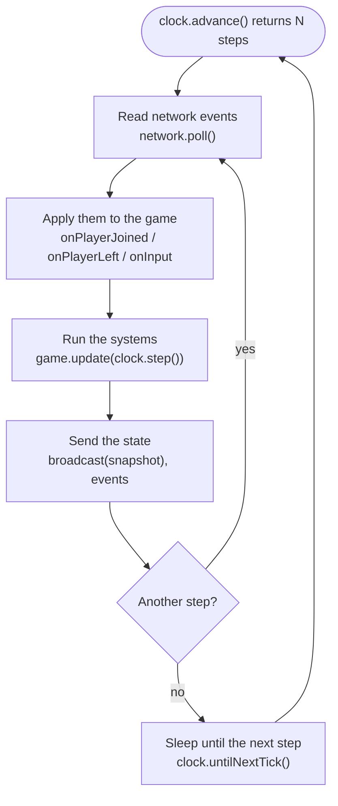
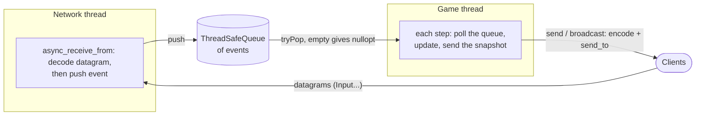
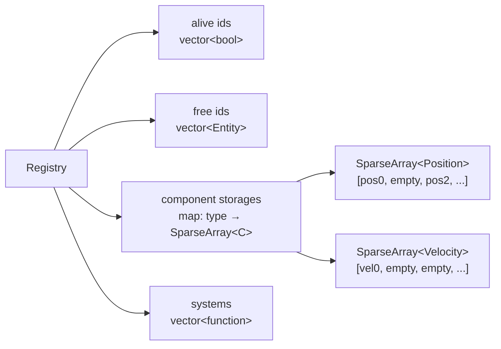

# Architecture Overview

This page gives the big picture: which subsystems exist, how they depend on each other, and where they live
in the code. The reasons behind each choice are in the [technical study](technical-study.md) and the
[architecture decision records](adr/README.md).

Each diagram is followed by a text description, so the page can be read without seeing the diagrams.

## 1. Layers

The subject requires visible and decoupled subsystems for rendering, networking and game logic.
The code is split into four modules. **Dependencies always go down, never up or sideways**: a module may use the
modules below it, never the ones above or beside it.



*Text description: `engine` is at the bottom and depends on nothing but the standard library.
`common` depends on `engine` (the protocol uses its serialization). `server` and `client` each depend directly on
both `common` (the protocol they share) and `engine` (ECS, game loop), but never on each other.*

| Module | Responsibility | Third-party libraries | CMake target |
|---|---|---|---|
| `engine/` | Generic game engine: knows nothing about R-Type | none | `rtype_engine` / `RTypeEngine::Engine` (interface target grouping enabled modules) |
| `common/` | What the server and the client must agree on: protocol, components, constants | none | `rtype_common` (static library) |
| `server/` | Authoritative game simulation and server networking | Asio | `rtype_server_lib` (game logic, tested) + `r-type_server` |
| `client/` | Display, keyboard input and client networking; sound integration remains pending | SFML, Asio | `r-type_client` |

The engine is also a separate CMake project. ECS and Core are static libraries; Physics, Net and Systems
are header-only targets. Systems depends on ECS, and Core provides the platform thread dependency.
Modules are selected at build time and exported for `find_package` consumers; no dynamic plugin loader exists.
See the [engine guide](engine.md) and [technical study](technical-study.md#standalone-engine-and-module-choices-implemented).

Rules every contributor follows ([CONTRIBUTING](https://github.com/EpitechPGE3-2026/G-ING-500-MAR-5-1-rtype-5/blob/main/CONTRIBUTING.md)):
- `engine/` never includes anything from `common/`, `server/` or `client/`.
- SFML is only used in `client/`. Asio is only used in network implementation files.

## 2. Subsystems and where they are in the code



*Text description: the engine offers six reusable building blocks. The protocol uses the engine's
serialization. On the server, the main loop uses the fixed timestep clock, drives the game logic and talks to
the network layer. The current game logic uses the ECS, movement system, AABB collisions and shared components.
The event bus is available but is not wired into Game. Both network layers use the protocol and a thread-safe
queue. The client renders entities directly from the latest snapshot rather than keeping a local ECS.*

| Subsystem | Main files | Status |
|---|---|---|
| ECS | `engine/include/engine/ecs/` (`Entity.hpp`, `SparseArray.hpp`, `Registry.hpp`), `engine/src/Registry.cpp` | Implemented |
| Game loop | `engine/include/engine/core/FixedTimestep.hpp`, `engine/src/FixedTimestep.cpp` | Implemented |
| Physics | `engine/include/engine/physics/Aabb.hpp`, `engine/include/engine/systems/Movement.hpp` | Implemented |
| Events | `engine/include/engine/core/EventBus.hpp` | Implemented |
| Serialization | `engine/include/engine/net/ByteBuffer.hpp` | Implemented; bounded big-endian reader and writer |
| Threading | `engine/include/engine/core/ThreadSafeQueue.hpp` | Implemented; mutex-protected FIFO queue |
| Protocol | `common/include/common/Protocol.hpp`, `common/src/Protocol.cpp`, [protocol.md](protocol.md) | Implemented; validates datagrams and message payloads |
| Shared components | `common/include/common/Components.hpp`, `common/include/common/Constants.hpp` | Implemented |
| Game logic | `server/src/Game.hpp`, `server/src/Game.cpp` and `server/src/Game*.cpp` (one file per part of the game) | Player movement, shooting, enemy spawning, missile/enemy collisions, score and snapshots |
| Server network | `server/src/net/INetworkServer.hpp`, `server/src/net/AsioNetworkServer.cpp` | Implemented; UDP handshake, inputs, snapshots, ping/pong and timeout handling |
| Client network | `client/src/net/INetworkClient.hpp`, `client/src/net/AsioNetworkClient.cpp` | Implemented; UDP connection retry, input sending and server timeout detection |
| Rendering | `client/src/main.cpp`, `client/src/ResourceManager.cpp` | Sprites for players, missiles and enemies; no starfield or audio integration yet |

## 3. Client–server model

The server is the only authority on the game. Clients send what the player presses; the server sends back
the whole state of the game, 60 times per second.



*Text description: the client network thread retries `Connect` every 500 ms while it is not connected.
The server assigns one of four player ids. The client sends its held input flags while connected. The server
converts received datagrams into game-thread events and broadcasts a snapshot after each simulation tick. The
client's rendering thread drains decoded messages and displays the latest snapshot. A disconnect or timeout
removes the player's entity; the server broadcasts an `EntityDestroyed` message.*

Snapshots are periodically resent, so a lost snapshot is replaced by a later one. Individual UDP events are not
reliably retransmitted; the current prototype has no acknowledgements, sequence-window handling or
interpolation. The server rejects a fifth player and removes clients that have sent no datagram for five seconds.
Full specification: [protocol.md](protocol.md).

## 4. Server: one tick



*Text description: each loop asks the clock how many fixed steps are due. For each step, the server reads
the network events, applies them to the game, runs every system once, then sends the snapshot and events.
When no step is left, it sleeps until the next one is due.*

This loop is in `server/src/main.cpp`. `AsioNetworkServer` owns the UDP socket and its I/O thread. The main
thread drains the event queue, calls the corresponding `Game` methods, advances the simulation and asks the
network layer to broadcast snapshots and destruction events. `Game` never touches sockets, so its behavior can
be unit tested without a network.

## 5. Threads

A **thread** is a second flow of execution running another function at the same time, in the same program and
with the same memory (`std::thread`). Each program has two:

- the **network thread**, which runs Asio's asynchronous receive, timer and send handlers;
- the **game thread** (on the client, the rendering thread), the one running `main` and processing queued messages.

Asio receives datagrams asynchronously on its own I/O thread. The game and rendering loops therefore do not
wait for network packets.



*Text description: clients send datagrams to the server's UDP port. Asio's I/O thread decodes each valid packet
and pushes the resulting event (player joined, left, input) into a thread-safe queue. At each step, the game
thread drains the available messages, runs the simulation and posts snapshots and game events to the network
thread for delivery.*

**The queue between the two threads.** Both threads use the same queue. A mutex protects its internal FIFO
storage from concurrent access. `tryPop` never waits for a message: when the queue is empty it returns
`std::nullopt` after acquiring its mutex. It can wait for that mutex; it is not a lock-free queue.

```cpp
// Network thread, after decoding an Input datagram:
_events.push(PlayerInput{player, input->flags});

// Game thread, at the start of each step: take every event until the queue is empty.
while (auto event = network.poll())   // poll() calls tryPop()
    apply(*event);                    // onPlayerJoined / onPlayerLeft / onInput
```

**Sending.** `send(player, message)` and `broadcast(message)` post work to the Asio I/O thread. That thread
encodes each message and sends it to the endpoint remembered during the handshake. Client endpoint state is
owned by that I/O thread, so it does not need a separate mutex.

**Ports.** The server listens on UDP port 4242 by default; the port can be changed on the command line. A client does not choose its local port: the
operating system gives it a free one when it sends its first datagram, and the server learns it from the
sender address of each datagram it receives.

The client follows the same idea: its network thread fills a queue that the main (rendering) thread empties every
frame before drawing. The client sends held input flags while connected; the server remains authoritative for
player positions. The current client draws the snapshot entities directly as sprites rather than storing
them in a local ECS.

## 6. Inside the engine: the ECS



*Text description: the `Registry` owns four things: which ids are alive, which ids can be reused, one storage
per component type, and the list of systems. Each storage is a `SparseArray`, a vector indexed by entity id
where a slot is either a component or empty.*

- An **entity** is only an id (`std::uint32_t`). It has a component when the slot at its index is filled.
- A **system** is a function `void(Registry &, float timeStepSeconds)`. `Registry::update` runs them in the order
  they were added.
- `Registry::each<Position, Velocity>(function)` calls the function for every live entity having *all* the
  listed components.

The engine is documented in more detail in [engine.md](engine.md).
