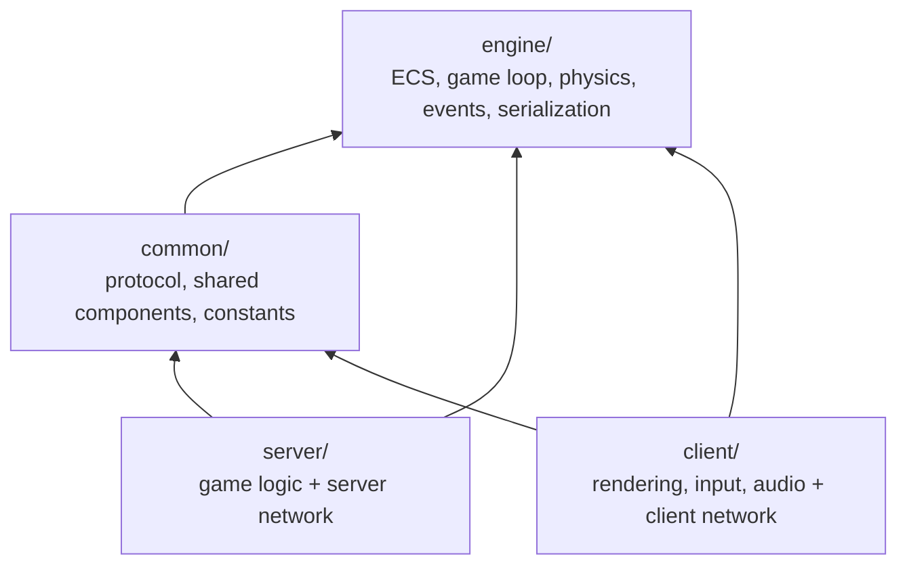
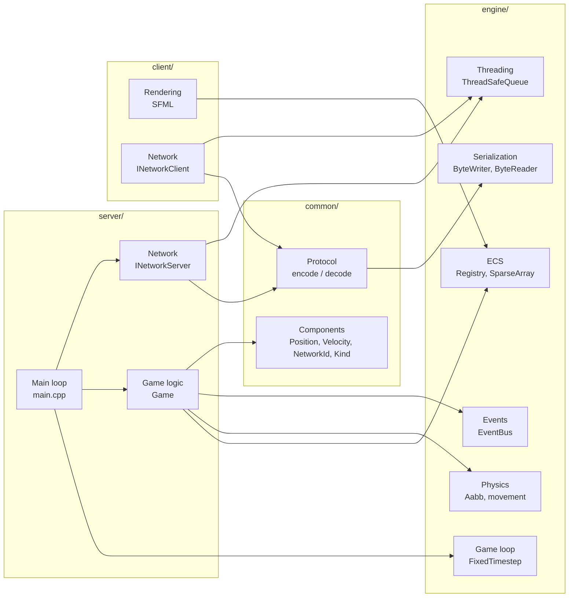
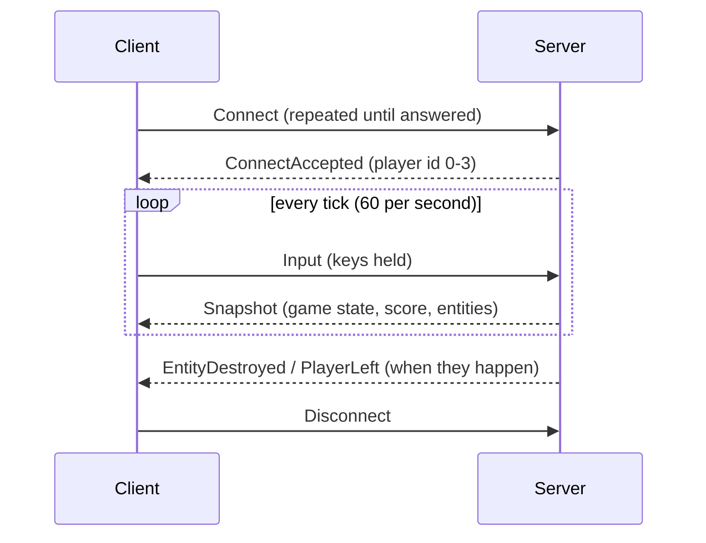
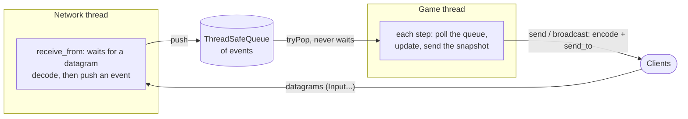
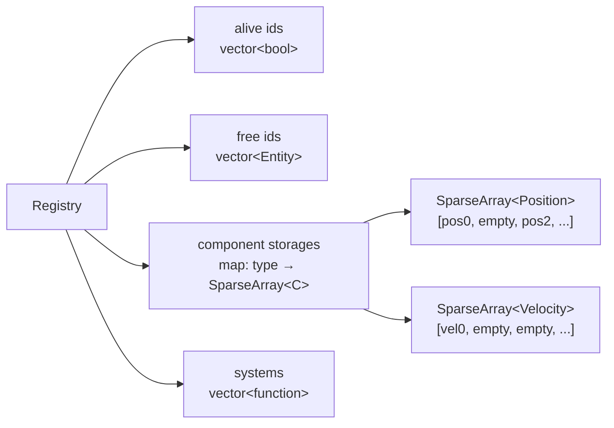

# Architecture Overview

This page gives the big picture: which subsystems exist, how they depend on each other, and where they live
in the code. The reasons behind each choice are in the [technical study](technical-study.md) and the
[architecture decision records](adr/README.md).

Each diagram is followed by a text description, so the page can be read without seeing the diagrams.

## 1. Layers

The subject requires visible and decoupled subsystems for rendering, networking and game logic.
The code is split into four modules. **Dependencies always go down, never up or sideways**: a module may use the
modules below it, never the ones above or beside it.



*Text description: `engine` is at the bottom and depends on nothing but the standard library.
`common` depends on `engine` (the protocol uses its serialization). `server` and `client` each depend directly on
both `common` (the protocol they share) and `engine` (ECS, game loop), but never on each other.*

| Module | Responsibility | Third-party libraries | CMake target |
|---|---|---|---|
| `engine/` | Generic game engine: knows nothing about R-Type | none | `rtype_engine` (static library) |
| `common/` | What the server and the client must agree on: protocol, components, constants | none | `rtype_common` (static library) |
| `server/` | Authoritative game simulation and server networking | Asio | `rtype_server_lib` (game logic, tested) + `r-type_server` |
| `client/` | Display, keyboard input, sound and client networking | SFML, Asio | `r-type_client` |

Rules every contributor follows ([CONTRIBUTING](https://github.com/EpitechPGE3-2026/G-ING-500-MAR-5-1-rtype-5/blob/main/CONTRIBUTING.md)):
- `engine/` never includes anything from `common/`, `server/` or `client/`.
- SFML is only used in `client/`. Asio is only used in network implementation files.

## 2. Subsystems and where they are in the code



*Text description: the engine offers six independent building blocks. The protocol uses the engine's
serialization. On the server, the main loop uses the fixed timestep clock, drives the game logic and talks to
the network layer. The game logic uses the ECS, physics, events and the shared components. Both network layers
use the protocol and a thread-safe queue. The client renders the entities stored in its own ECS.*

| Subsystem | Main files | Status |
|---|---|---|
| ECS | `engine/include/engine/ecs/` (`Entity.hpp`, `SparseArray.hpp`, `Registry.hpp`), `engine/src/Registry.cpp` | Implemented |
| Game loop | `engine/include/engine/core/FixedTimestep.hpp`, `engine/src/FixedTimestep.cpp` | Implemented |
| Physics | `engine/include/engine/physics/Aabb.hpp`, `engine/include/engine/systems/Movement.hpp` | Implemented |
| Events | `engine/include/engine/core/EventBus.hpp` | Implemented |
| Serialization | `engine/include/engine/net/ByteBuffer.hpp` | Designed |
| Threading | `engine/include/engine/core/ThreadSafeQueue.hpp` | Designed |
| Protocol | `common/include/common/Protocol.hpp`, `common/src/Protocol.cpp`, [protocol.md](protocol.md) | Designed |
| Shared components | `common/include/common/Components.hpp`, `common/include/common/Constants.hpp` | Implemented |
| Game logic | `server/src/Game.hpp`, `server/src/Game.cpp` | Designed |
| Server network | `server/src/net/INetworkServer.hpp` | Designed |
| Client network | `client/src/net/INetworkClient.hpp` | Designed |
| Rendering | `client/src/main.cpp` | Window only |

"Designed" means the header (the contract) and the unit tests exist; the implementation is in progress.

## 3. Client–server model

The server is the only authority on the game. Clients send what the player presses; the server sends back
the whole state of the game, 60 times per second.



*Text description: the client sends `Connect` until the server answers `ConnectAccepted` with a player id.
Then, every tick, the client sends its `Input` and the server sends a `Snapshot`. The server also sends
`EntityDestroyed` and `PlayerLeft` when they happen. The client sends `Disconnect` when it leaves.*

Why it works over UDP: a lost `Snapshot` is replaced by the next one 16.7 ms later, so the client never stays
out of sync. The end of the game is part of the snapshot (`state = finished`), so it cannot be lost.
Full specification: [protocol.md](protocol.md).

## 4. Server: one tick


*Text description: each loop asks the clock how many fixed steps are due. For each step, the server reads
the network events, applies them to the game, runs every system once, then sends the snapshot and events.
When no step is left, it sleeps until the next one is due.*

This loop is in `server/src/main.cpp`. The game logic (`Game`) never touches sockets: `main` gives it the
network events and sends what it produces, so it can be unit tested without a network.

## 5. Threads

A **thread** is a second flow of execution running another function at the same time, in the same program and
with the same memory (`std::thread`). Each program has two:

- the **network thread**, created by `network.start(port)`, which does nothing but wait for datagrams;
- the **game thread** (on the client, the rendering thread), the one running `main`, which must never wait.

Receiving on a socket blocks until a datagram arrives: if the game loop did it, the simulation would freeze
whenever nobody sends anything. This is why receiving is done by its own thread.



*Text description: clients send datagrams to the server's UDP port. The network thread waits for them, decodes
each one and pushes the resulting event (player joined, left, input) into a thread-safe queue. At each step, the
game thread takes every event from the queue without ever waiting, runs the simulation and sends the snapshot to
the clients with `send` and `broadcast`.*

**The queue between the two threads.** Both threads use the same queue. If they modified a `std::queue` at the
same moment, its internal state would be corrupted (a *data race*). A mutex, a lock that only one thread can hold
at a time, prevents it. `tryPop` never waits for a message: when the queue is empty it returns `std::nullopt`.

```cpp
// Network thread, after decoding an Input datagram:
_events.push(PlayerInput{player, input->flags});

// Game thread, at the start of each step: take every event until the queue is empty.
while (auto event = network.poll())   // poll() calls tryPop()
    apply(*event);                    // onPlayerJoined / onPlayerLeft / onInput
```

**Sending.** `send(player, message)` encodes the message and sends the bytes to the address of that player,
remembered when it connected. `broadcast(message)` does the same for every connected player. They can be called
from the game thread because the list of clients they read is protected by a mutex.

**Ports.** The server listens on a fixed UDP port (4242 by default). A client does not choose its port: the
operating system gives it a free one when it sends its first datagram, and the server learns it from the
sender address of each datagram it receives.

The client follows the same idea: its network thread fills a queue that the main (rendering) thread empties every
frame before drawing. The game logic therefore never waits for the network, and a slow or silent client cannot
block the simulation.

## 6. Inside the engine: the ECS



*Text description: the `Registry` owns four things: which ids are alive, which ids can be reused, one storage
per component type, and the list of systems. Each storage is a `SparseArray`, a vector indexed by entity id
where a slot is either a component or empty.*

- An **entity** is only an id (`std::uint32_t`). It has a component when the slot at its index is filled.
- A **system** is a function `void(Registry &, float timeStepSeconds)`. `Registry::update` runs them in the order
  they were added.
- `Registry::each<Position, Velocity>(function)` calls the function for every live entity having *all* the
  listed components.

The engine is documented in more detail in [engine.md](engine.md).
