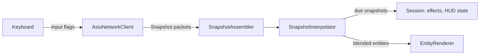

# Client

`r-type_client` shows the game and sends the player's actions. It decides nothing about the game: the server
is the authority, and the client draws what the snapshots contain.

## Files

| File | Role |
|---|---|
| `client/src/main.cpp` | Command-line arguments, then the application |
| `client/src/App.cpp` | One state per screen (menu, campaign map, editor, game); hosts the local server; F1/F2/F3; where Escape leads |
| `client/src/ui/CampaignMap.cpp` | Campaign map: one node per level, locked levels, difficulty, progress saved in `config.json` |
| `client/src/editor/LevelEditor.cpp`, `LevelEditorDraw.cpp` | Level editor inside the game, on an engine `Registry` |
| `client/src/render/WorldBackground.cpp` | Background of each world, drawn in code: stars at three depths, the landmark of the world, walls scrolling at the speed of the game |
| `client/src/render/Neon.cpp` | Drawing toolkit used by every picture of the game: black shapes and lines of light, copied to the glow layer of the Neon styles |
| `client/src/render/Looks.hpp` | Enemy variants, the colour of each world, the colours of the players and of danger |
| `client/src/ui/MainMenu.cpp` | Menu screens: join a server, settings (volumes, auto fire, high contrast, key remapping) |
| `client/src/ui/GameConfig.cpp` | Settings saved in `config.json`; an invalid file falls back to the defaults |
| `client/src/game/Session.cpp` | One game: inputs sent, snapshots received and smoothed, effects of destroyed entities |
| `client/src/game/SessionHud.cpp` | HUD: score, wave, lives of every player, banners, waiting room, end screen |
| `client/src/render/EntityRenderer.cpp` | One drawing function per entity type and variant |
| `client/src/net/AsioNetworkClient.cpp` | UDP connection on its own thread (see [networking](networking.md)) |
| `client/src/ResourceManager.cpp` | Textures, font, music and sounds loaded from `assets/` |

## One frame

*Every frame, the session sends the held actions, merges the snapshot packets of each tick, then handles the
snapshots whose time has come (sounds, explosions, HUD) and draws the entities blended between two snapshots.*

1. `Session::sendInput` turns the held keys into input flags. With auto fire, Shoot is sent without holding the key.
   Without the window focus, an empty input is sent, so another window's keys never move the ship.
2. `Session::receive` merges the packets of a tick (`SnapshotAssembler`) and queues the complete snapshot in the
   `SnapshotInterpolator`, which shows the world about two snapshots in the past.
3. A snapshot whose time has come updates the score, lives, level, wave and game state.
4. An `EntityDestroyed` from the server says why an entity disappeared. Only a killed one explodes (with its sound,
   flash or screen shake); a bonus that was picked up or an entity that left the screen does not. The entity is hidden
   at once, until the snapshots drop it too. A `PlayerLeft` shows "P2 LEFT THE GAME" for a few seconds.
5. `Session::draw` draws the blended entities, then the HUD.

## Drawing an entity

The server sends a type and a variant; `EntityRenderer::draw` chooses the drawing function from the type. The
variant comes from the `Kind` of the entity's prefab in `assets/config/entities.json`.

| Type | Function | Variants |
|---|---|---|
| Player | `drawShip` | Player index: colour of the cockpit, wings and engine, "P1"..."P4" tag; tilt follows vertical movement |
| Player missile | `drawPlayerShot` | `0` blaster, `1` laser (longer, pink) |
| Enemy missile | `drawEnemyShot` | `0` to `4`: always red with a white-hot centre; the shape tells the pattern |
| Enemy | `drawEnemy` | Named in `render/Looks.hpp`: `10` to `12` Orbital belt, `13` to `15` Mars, `16` to `18` Singularity, `30` to `32` the three bosses; `0` to `7` the first enemies of the project |
| Obstacle | `drawObstacle` | `0` torn solar panel, `1` Martian rock, `2` singularity crystal |
| Bonus | `drawBonus` | Turning diamond with an icon: three lines spread, one beam laser, a cross extra life |

Everything is drawn with `neon::Canvas` (`client/src/render/Neon.hpp`): black shapes that hide what is behind them
and lines of light, also drawn on the glow layer so that the Neon and Arcade styles make them shine. Enemies are drawn
in the colour of their world with a red eye; red is kept for what hurts. To show a new enemy variant, give it a name in
`render/Looks.hpp`, a drawing function in `render/EntityRenderer.cpp`, and use the variant in the prefab.

## Settings and accessibility

Settings are read from `config.json` at startup and written when the client closes or a setting changes.
Remapped keys must all differ; a conflict resets the controls to the defaults. Auto fire (F1) and high contrast (F2)
can be toggled in game. High contrast removes the starfield and the screen shake, softens the damage flash,
outlines the HUD text and circles every enemy shot. See the [accessibility study](accessibility.md).

## Leaving a game

Escape returns to the menu. A refused connection, an unreachable server or a lost connection also returns to the
menu, with a message explaining why. F3 shows the network statistics: ping, bandwidth, loss, dropped and resent packets.
