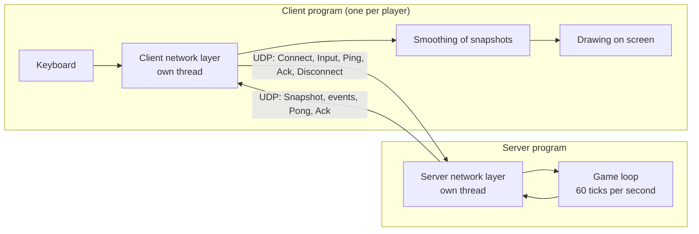
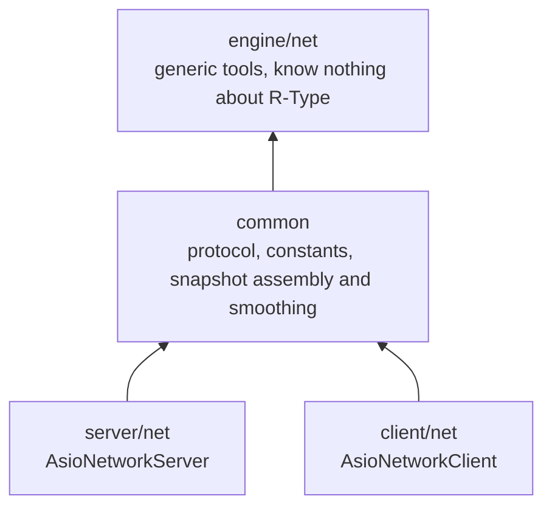
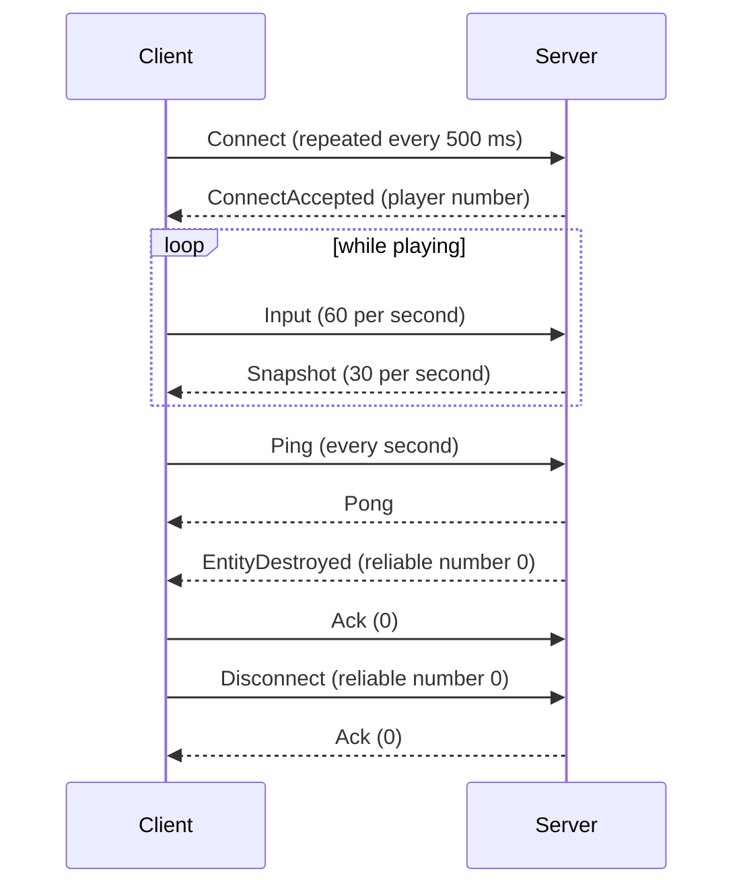
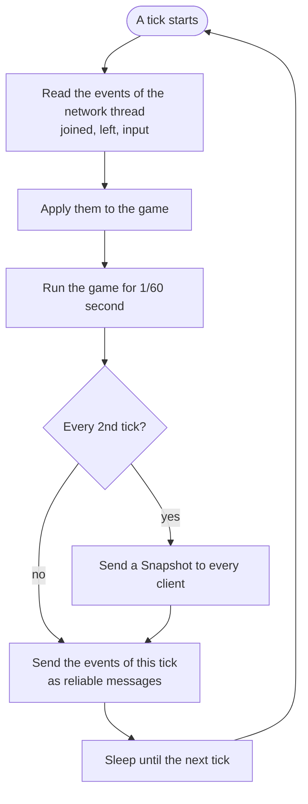

# Network guide: how the network works, from A to Z

This guide explains the whole network of the game, from the bytes on the wire to the picture on the screen.
Read it from the top to understand everything, or jump to a section with the table of contents of the page.

It does not repeat every detail. The exact bytes of each message are in the [protocol specification](protocol.md),
the reasons for each choice are in the [decision records](adr/README.md), and the measurements are in the
[networking implementation page](networking.md). A French version of this guide follows the English one.

## 1. The big picture

The game is a networked shooter. Up to 4 players, each with their own program (the **client**), play together in one
game run by a central program (the **server**). The server is the **authority**: it alone decides what happens.

- A client only sends **which keys the player holds**. It never says "my ship is at this position".
- The server moves everything, checks the collisions, and sends back **the state of the game**.
- Each client **draws** the state it receives. A modified client cannot cheat by moving faster or by teleporting.

All the game traffic uses **UDP** (User Datagram Protocol), as the subject requires. UDP sends independent small
messages called **datagrams**. It is fast, but it gives **no guarantee**: a datagram can be lost, arrive twice, or
arrive after a later one. Most of this guide is about living with that.



*Text description: each client reads the keyboard and sends its key presses over UDP to the server through its network
layer. The server network layer hands them to the game loop, which runs 60 times per second, and sends back the state
of the game. On the client, the received state is smoothed and then drawn.*

| Direction | What is sent | How often |
|---|---|---|
| Client to server | `Input`: the keys held right now | 60 per second |
| Client to server | `Ping` (to measure the delay), `Ack` (receipt of an important message), `Disconnect` | 1 per second, when needed |
| Server to client | `Snapshot`: the whole game at one tick | 30 per second |
| Server to client | `EntityDestroyed`, `PlayerLeft`: important events | when they happen |
| Server to client | `Pong`, `Ack`, and the answers to `Connect` | when needed |

## 2. The code: who does what

The code is split in layers. A layer only uses the layers below it.



*Text description: `engine/net` is at the bottom and depends on nothing. `common` uses it. The server and the client
network layers each use `common`, and never each other.*

| Where | File | Role |
|---|---|---|
| `engine/net` | `ByteBuffer.hpp` | Writes and reads numbers byte by byte, in network order (big-endian), with bounds checks |
| `engine/net` | `SequenceWindow.hpp` | Remembers the last 32 packet numbers of a peer: spots duplicates and late packets |
| `engine/net` | `ReliableQueue.hpp` | Keeps important messages until the peer confirms them, and sends them again |
| `engine/net` | `RateLimiter.hpp` | Token bucket: refuses a sender that goes over its allowed rate |
| `engine/net` | `LossTracker.hpp`, `TrafficStats.hpp` | Estimate the loss, count bytes and packets, compute bandwidth |
| `common` | `Protocol.hpp/.cpp` | Every message, `encode`, `decode`, position quantization, snapshot splitting |
| `common` | `Constants.hpp` | Ports, rates, timeouts, limits |
| `common` | `SnapshotAssembler.hpp` | Puts back together the packets of one tick, ignores old or repeated ones |
| `common` | `SnapshotInterpolator.hpp` | Shows the world slightly in the past and blends two snapshots |
| `server/net` | `INetworkServer.hpp`, `AsioNetworkServer.cpp` | The server's socket, its clients, its timers |
| `client/net` | `INetworkClient.hpp`, `AsioNetworkClient.cpp` | The client's socket, the connection states, its timers |
| `scripts` | `netsim.py` | UDP proxy that loses, delays and repeats datagrams, to test on a bad network |

The two `INetwork...` files are **contracts**: the game only sees them, never the Asio library. Asio is the C++ library
that does the real socket work, in the two `Asio...` files only (see [ADR 0003](adr/0003-asio-networking.md)).

## 3. On the wire: packets and messages

One UDP datagram carries exactly one **packet**, at most **1200 bytes** (so that it is not cut up on the way).
Every number is written **big-endian** (the most significant byte first).

### 3.1 The packet header (10 bytes)

| Offset | Size | Field | Meaning |
|---|---|---|---|
| 0 | 2 bytes | magic | Always `0x5254` ("RT"): a packet from another program is dropped at once |
| 2 | 1 byte | version | Version of the protocol, currently `7` |
| 3 | 1 byte | type | The message type; bit `0x40` set means "reliable message" |
| 4 | 4 bytes | sequence | Number of this packet for this peer (0, 1, 2...) |
| 8 | 2 bytes | payload size | Bytes after the header |

Example: an `Input` with the keys Up and Shoot held, as packet number 42, takes 11 bytes:

```text
52 54  07  02  00 00 00 2A  00 01   11
magic  ver type  sequence   size    flags (Up = 0x01, Shoot = 0x10)
```

### 3.2 The messages

| Type | Name | Direction | Payload | Reliable |
|---|---|---|---|---|
| `0x01` | Connect | client to server | none | no, but repeated until answered |
| `0x02` | Input | client to server | 1 byte: keys held (up 1, down 2, left 4, right 8, shoot 16) | no |
| `0x03` | Disconnect | client to server | none | yes |
| `0x04` | Ping | client to server | timestamp in milliseconds | no |
| `0x05` | Ack | both | number of the reliable message confirmed | no |
| `0x81` | ConnectAccepted | server to client | player number 0 to 3 | no |
| `0x82` | ConnectRejected | server to client | reason: 1 server full, 2 other version | no |
| `0x83` | Snapshot | server to client | the game state (section 6) | no |
| `0x84` | EntityDestroyed | server to client | entity id, reason | yes |
| `0x85` | PlayerLeft | server to client | player number, reason | yes |
| `0x86` | Pong | server to client | the timestamp of the `Ping` | no |

A **reliable** message has bit `0x40` set in its type, and its payload starts with a 4-byte **reliable number**.
Example: `EntityDestroyed` for entity 77 (reason 1 = killed), reliable number 5, packet number 9:

```text
52 54  07  C4  00 00 00 09  00 09   00 00 00 05  00 00 00 4D  01
magic  ver type  sequence   size    reliable no.  entity id    reason
```

### 3.3 What the receiver checks

A datagram that is not perfectly valid is **dropped without a reply** and never reaches the game. It is dropped if it
is too short or too long, if the magic or the version is wrong, if the size field lies, if the type is unknown, if the
payload size is wrong for its type, or if a field has a value that does not exist. The decoder never throws and never
reads past the end of the datagram.

## 4. A session, from start to end



*Text description: the client sends `Connect` until the server answers `ConnectAccepted` with a player number. During
the game the client sends `Input` 60 times per second and the server sends `Snapshot` 30 times per second. Once per
second the client sends a `Ping` and the server answers `Pong`. When an important event happens, the server sends it
as a reliable message and the client confirms it with an `Ack`. At the end the client sends a reliable `Disconnect`,
and the server confirms it.*

### 4.1 Connecting

1. The client resolves the address and opens a UDP socket. It sends `Connect`, and **repeats it every 500 ms**.
2. The server identifies a client by its **address and port**. It gives the first free slot out of 4 and answers
   `ConnectAccepted`. A repeated `Connect` from the same address gets the same slot again, so repeating is harmless.
3. If the 4 slots are taken, the server answers `ConnectRejected` (server full). If the `Connect` is written for
   another protocol version, the server answers `ConnectRejected` (other version) **in the version of the client**, so
   that the client can read it.
4. After 10 attempts without any answer (about 5 seconds), the client gives up.

### 4.2 The states of a client

The client network layer always knows where it stands. The graphical client reads this state every frame.

| State | Meaning | What the game does |
|---|---|---|
| `Idle` | Not connected | Menu |
| `Connecting` | `Connect` sent, no answer yet | "Connecting to server..." |
| `Connected` | The server accepted and keeps answering | Play |
| `Rejected` | The server refused (full, or other version) | Back to the menu with the reason |
| `TimedOut` | The server never answered | Back to the menu: "Could not reach the server" |
| `Lost` | The server was there, then went silent for 5 seconds | Back to the menu: "Connection lost" |

`Rejected`, `TimedOut` and `Lost` are final: a late packet cannot bring a dead session back. `disconnect()` returns
to `Idle`, and `connect()` can be called again.

### 4.3 Leaving, and the timeouts

- The client sends a **reliable** `Disconnect` and waits up to 500 ms for its `Ack`. The server then removes the ship
  at once and tells the other clients with `PlayerLeft`.
- If a client crashes, the server hears nothing. After **5 seconds of silence** it removes the client the same way.
  The `Ping` of every second keeps a quiet but living client from being removed.
- If the **server** goes silent for 5 seconds, the client moves to `Lost`.

## 5. One tick of the server

The server's main loop uses a **fixed time step**: the game always advances by 1/60 second, whatever the speed of the
computer, and catches up if it was late.



*Text description: at each tick the server reads the events collected by the network thread, applies them to the game,
and runs the game for 1/60 second. Every second tick it sends a snapshot to every client. It always sends the events
of the tick (such as destroyed entities) as reliable messages, then sleeps until the next tick.*

**Two threads per program.** The game never waits for the network, as the subject requires.

- The **network thread** runs Asio. It receives datagrams, decodes and checks them, answers by itself what does not
  concern the game (the handshake, `Ping`, `Ack`), and puts the rest in a queue.
- The **game thread** (the main one) takes events from that queue at each tick, and posts what it wants to send back
  to the network thread. The queue is protected by a mutex (`ThreadSafeQueue`).

The client works the same way: its network thread fills a queue, and the drawing thread empties it every frame.

## 6. Snapshots: what is sent, and how it is drawn

A **snapshot** is the whole game at one tick. A lost one is replaced by the next, so snapshots need no repeat.

### 6.1 Content

| Field | Size | Meaning |
|---|---|---|
| tick | 4 bytes | Number of the tick (a counter that goes up by 2 here) |
| state | 1 byte | Waiting, playing, finished (victory) or game over (defeat) |
| score | 4 bytes | The team's score |
| lives | 4 bytes | Lives left of each of the 4 players |
| count | 2 bytes | Number of entities that follow |
| entities | 10 bytes each | Id (4), type (1), variant (1), x (2), y (2) |

An entity is sent with its **network id**, never its local ECS (Entity-Component-System) index, because that index is
different on every computer.

### 6.2 Making a position small (quantization)

A position uses 2 bytes: a number of **1/16 of a world unit**, starting from −1024. For `x = 640.25`:
`(640.25 + 1024) × 16 = 26628`, which is `0x6804`. The receiver computes `26628 / 16 − 1024 = 640.25`. The error is at
most 1/32 of a unit, far less than a pixel. A value outside −1024 to +3071.94 is clamped to the nearest end and never
wraps around. This makes an entity cost 10 bytes instead of 14.

### 6.3 Too many entities for one datagram

A datagram holds at most 117 entities. The server cuts a bigger snapshot into several packets with the **same tick**.
The client's `SnapshotAssembler` puts them back together, ignores a snapshot older than what it has, and ignores the
copy of a packet it already merged.

### 6.4 Smoothing on the client

The server sends 30 snapshots per second but the screen is drawn 60 times per second, and the network delivers packets
with some irregularity (**jitter**). Drawing each snapshot on arrival would make entities move by uneven jumps. So the
client uses **interpolation**:

1. It keeps the last few snapshots and shows the world **2 sending intervals in the past** (66 ms by default).
2. At each frame it finds the two snapshots around the time being shown and puts each entity on the **straight line**
   between its two positions.
3. A snapshot is **handled** (sounds, explosions, score, lives) when its time comes, so what you hear matches what you see.
4. If one snapshot is lost, its neighbours hide the gap. If nothing new arrives, the last snapshot is held.

The price is a longer delay before the player sees an event: about 100 ms instead of 16 ms. See
[ADR 0010](adr/0010-snapshot-rate-and-interpolation.md).

## 7. Coping with a bad network

| Problem | What protects the game | Where |
|---|---|---|
| A packet is **lost** (snapshot) | The next snapshot replaces it; interpolation hides the gap | section 6 |
| A packet is lost (important event) | **Reliable messages**: confirmed with an `Ack`, repeated until confirmed | 7.2 |
| A packet arrives **twice** | **Sequence window**: the copy is ignored | 7.1 |
| Packets arrive **out of order** | Sequence window: a late `Input` or `Snapshot` is dropped, a late `Ping` is answered | 7.1 |
| The delay is **irregular** (jitter) | Interpolation | 6.4 |
| A client **floods** the server | **Rate limit** per client; replies to strangers are limited | 7.3 |
| A packet is **malformed** | The decoder drops it; nothing reaches the game | 3.3 |
| A client **crashes** | 5 seconds of silence, then `PlayerLeft` to the others | 4.3 |
| The **server** disappears | The client moves to `Lost` after 5 seconds and returns to the menu | 4.2 |
| A client has **another version** | The server answers `ConnectRejected` in the client's version | 4.1 |
| An **exception** in a network handler | It is caught and shown; the network thread keeps running | 7.4 |

### 7.1 Sequence numbers

Each peer numbers the packets it sends to **each** other peer: the server has one counter per client. The receiver
keeps the highest number seen and a **window of 32 bits** telling which of the 32 numbers before it arrived. From that,
each packet is **new** (higher than all others), **late** (lower, never seen), a **duplicate** (seen) or **too old**.
A duplicate and a too-old packet are always dropped. A late `Input` or `Snapshot` is dropped too, because a newer one
already replaced it. The window uses 8 bytes per peer and follows the counter when it wraps around at 2³².

The numbers also tell the client how many packets were lost: a hole in the numbers is a lost packet. That gives the
**loss** value shown by the F3 screen.

### 7.2 Reliable messages

Most traffic must **not** be reliable: a snapshot is replaced 33 ms later, so repeating it would waste bandwidth.
Three messages cannot be replaced, so they are reliable: `EntityDestroyed`, `PlayerLeft` and `Disconnect`.

1. The sender gives the message a **reliable number** and keeps it in a `ReliableQueue` for that peer.
2. The receiver answers every copy with a small `Ack` carrying the number (even a copy: the first `Ack` may be what was lost).
3. Until the `Ack` arrives, a timer (every 50 ms) sends the message again, **in a new packet**.
4. The wait before a repeat follows the measured round-trip time (RTT) of the connection, as TCP does, and **doubles at each
   repeat** (never above 1 second). After 12 sends the sender gives up: the peer is probably gone.
5. The receiver remembers the last 32 reliable numbers, so a repeat is **never handled twice**.
6. At most 32 reliable messages are in flight at once, so that a repeat can always be told from a new message.

Reliable messages are **not ordered** between themselves. See [ADR 0009](adr/0009-reliable-messages-over-udp.md).

### 7.3 Rate limits

A server must stay up when someone floods it. It uses a **token bucket** for each sender: a steady rate plus a short burst.

- A connected client may send **300 datagrams per second**, with a burst of 150. A normal client sends about 70.
- All the senders the server does not know share **50 replies per second** (burst 25).

A datagram over the limit is dropped **before anything is queued or answered**, and counted. The other clients are not
affected, and the sender is served again as soon as it slows down.

### 7.4 Never crash

An exception that escapes a network thread would stop the whole program. Both network threads catch exceptions, write
them on the error output and keep running. A datagram that makes a handler throw is dropped, and the socket keeps reading.

## 8. Measuring and testing

### 8.1 Tools

| Tool | How to use it | What it shows |
|---|---|---|
| Server statistics | `./r-type_server 4242 --stats` | Every 2 seconds: clients, bandwidth out and in (per client), totals, packets dropped, resent |
| Client statistics | Press **F3** while playing | Ping, download, upload, loss, packets dropped, resent |
| Bad network | `python3 scripts/netsim.py --listen 5000 --server 127.0.0.1:4242 --loss 10 --delay 80 --jitter 30 --dup 2` then connect the client to port 5000 | Loses, delays and repeats datagrams in both directions |

### 8.2 Automatic tests

| Test file | What it proves |
|---|---|
| `test_protocol.cpp` | Every message survives `encode` then `decode`; bad datagrams are refused; quantization stays within 1/32 unit |
| `test_sequence_window.cpp` | Duplicates, late and too-old packets, the 32-number window, the wrap-around |
| `test_reliable_queue.cpp` | Sending, repeating, backoff, adapting to the RTT, the window of 32, giving up (with a simulated clock) |
| `test_rate_limiter.cpp` | The burst, the steady rate, no saving up during a silence |
| `test_snapshot_interpolator.cpp` | Blending, new and removed entities, lost snapshots, smoothness under jitter |
| `test_traffic_stats.cpp` | Counters, bandwidth, loss estimate |
| `test_network_integration.cpp` | The real server with raw sockets: slots, numbering, filtering, reliable messages, flooding |
| `test_network_client.cpp` | The real client against a fake server: states, acknowledgements, disconnect |
| `test_network_loss.cpp` | The real client and server through a relay that loses 30 % of the datagrams: all reliable messages arrive once |

### 8.3 Results

Measured with a scripted client on a local campaign game (about 27 entities per snapshot), single runs, not a benchmark.
Details and conditions are in the [networking implementation page](networking.md).

| Step | Entity size | Snapshots per second | Download per client |
|---|---|---|---|
| First protocol | 14 bytes | 60 | 24.3 KB/s |
| Positions on 16 bits | 10 bytes | 60 | 17.6 KB/s |
| 30 snapshots per second with interpolation (now) | 10 bytes | 30 | **8.4 KB/s (−65 %)** |

| Network | Result |
|---|---|
| 30 % loss in each direction | All reliable messages arrive (48 of 48, then 50 of 50), 54 and 43 repeats |
| 30 ms of jitter | Largest jump of an entity between two frames: 26.7 units drawn on arrival, 8.4 interpolated (real speed 6.7) |
| 20 % loss, 60 ms delay | Loss measured 20.9 %, ping 139 ms |

## 9. Settings you can change

| What | Where | Default |
|---|---|---|
| Port of the server | `./r-type_server [port]` | 4242 |
| Statistics every 2 seconds | `./r-type_server --stats` | off |
| Snapshots every N ticks | `./r-type_server --snapshot-every N` or `SnapshotEveryTicks` | 2 (30 per second) |
| Server and client addresses | `./r-type_client [host] [port]` or the menu | 127.0.0.1 4242 |
| Delay of interpolation | `InterpolationDelaySnapshots` in `common/Constants.hpp` | 2 intervals |
| Silence before a client or the server is considered gone | `ClientTimeout` | 5 seconds |
| `Connect` repeat and number of attempts | `ConnectRetryInterval`, `MaxConnectAttempts` | 500 ms, 10 |
| `Ping` interval | `PingInterval` | 1 second |
| Rate limits | `ClientPacketsPerSecond`, `ClientPacketBurst`, `UnknownSenderRepliesPerSecond` | 300, 150, 50 |
| Reliable messages: first wait, limits, attempts | `ReliableQueue::Config` | 200 ms, 50 ms to 1 s, 12 |
| Timings of the client (for tests) | `AsioNetworkClient::Options` | the constants above |

## 10. How to extend the network

### Add a message

1. In `Protocol.hpp`: add a `MessageType` value, a struct with its fields, and the struct in the `Message` variant.
2. In `Protocol.cpp`: handle it in `typeOf`, in `writePayload`, and in the `switch` of `decode`, with its exact payload
   size and a check of every field that has a limited set of values.
3. Handle it in `AsioNetworkServer::handleDatagram` or in `AsioNetworkClient::handlePacket`.
4. **Raise `Version`**, write the message in [protocol.md](protocol.md), and add tests: a round trip, a bad size, a bad value.

### Send something reliably

Call `sendReliable` (client) or `sendReliable` / `broadcastReliable` (server) instead of `send` / `broadcast`.
Nothing else changes: the number, the `Ack`, the repeats and the filter of copies are done for you.

### Test a network problem

Use `FakeServer` in `test_network_client.cpp` to control exactly what a client receives. Use `LossyRelay` in
`test_network_loss.cpp` to put a lossy link between a real client and a real server.

## 11. Limits, and what could be done next

| Limit | Why, and what could be done |
|---|---|
| No encryption and no authentication | A client is known by its address and port only. Someone who can forge UDP packets with that address could send inputs or a `Disconnect` in its name. Tokens or a handshake with a secret would fix it |
| The player's own ship is shown late | It is interpolated like the rest. **Client-side prediction** with reconciliation would hide it, but the client would have to repeat the server's movement rules |
| Snapshots are complete | Delta snapshots were measured and rejected: 98 % of the entities move at every tick ([ADR 0011](adr/0011-delta-snapshots-not-adopted.md)) |
| No extrapolation | If nothing newer arrives, entities pause instead of continuing on their path |
| Reliable messages are not ordered | The game events are independent. An ordered channel would let one lost message block the following ones |
| A message is given up after 12 sends | The peer is then almost surely gone, and the 5 seconds timeout ends the session |
| One game per server, 4 players | A lobby and several games in parallel would need a manager above the game loop |
| IPv4 only | The client resolves addresses with `Udp::v4()` |
| Compression | Data is small and already packed; a general compressor was not needed |

## 12. Glossary

| Word | Meaning |
|---|---|
| Authoritative server | The server decides; clients only send their keys and draw what they receive |
| Datagram | One UDP message, independent of the others |
| Tick | One step of the game simulation: 1/60 second |
| Snapshot | The state of the whole game at one tick |
| Sequence number | Number of a packet for a given peer, used to spot duplicates and losses |
| Reliable message | A message that is confirmed with an `Ack` and sent again until it is |
| Ack | "Acknowledgement": a small message that confirms the receipt of a reliable message |
| RTT | Round-trip time: how long a message takes to go and for the answer to come back |
| Jitter | The irregularity of the delay between packets |
| Interpolation | Computing positions between two known snapshots |
| Quantization | Storing a number with fewer bits, accepting a tiny error |
| Token bucket | A way to limit a rate: a stock of tokens that refills at a steady speed |
| ADR | Architecture Decision Record: a short page that explains one important choice |

## 13. Read next

- [Network protocol](protocol.md): the exact bytes of every message and every rule.
- [Networking implementation](networking.md): code map, limits, tools, and all the measurements.
- Decision records: [Asio](adr/0003-asio-networking.md), [authoritative snapshots](adr/0007-authoritative-snapshots.md),
  [binary protocol](adr/0008-binary-protocol.md), [reliable messages](adr/0009-reliable-messages-over-udp.md),
  [snapshot rate and interpolation](adr/0010-snapshot-rate-and-interpolation.md),
  [delta snapshots not adopted](adr/0011-delta-snapshots-not-adopted.md).
- [Technical and comparative study](technical-study.md), section 5.

---

# Version française : le réseau de A à Z

Ce guide explique tout le réseau du jeu, des octets qui circulent jusqu’à l’image à l’écran. Lisez-le depuis le
début pour tout comprendre, ou allez directement à une section grâce à la table des matières de la page.

Il ne répète pas chaque détail. Les octets exacts de chaque message sont dans la
[spécification du protocole](protocol.md), les raisons de chaque choix dans les [décisions d’architecture](adr/README.md),
et les mesures dans la page [implémentation du réseau](networking.md).

## 1. Vue d’ensemble

Le jeu est un jeu de tir en réseau. Jusqu’à 4 joueurs, chacun avec son propre programme (le **client**), jouent
ensemble dans une partie gérée par un programme central (le **serveur**). Le serveur fait **autorité** : lui seul
décide de ce qui se passe.

- Un client envoie seulement **les touches que le joueur maintient**. Il ne dit jamais « mon vaisseau est à cette
  position ».
- Le serveur déplace tout, teste les collisions, et renvoie **l’état du jeu**.
- Chaque client **dessine** l’état qu’il reçoit. Un client modifié ne peut pas tricher en allant plus vite ou en se
  téléportant.

Tout le trafic de jeu utilise **UDP** (User Datagram Protocol), comme l’impose le sujet. UDP envoie de petits messages
indépendants appelés **datagrammes**. C’est rapide, mais **sans aucune garantie** : un datagramme peut se perdre,
arriver deux fois, ou arriver après un plus récent. Une grande partie de ce guide explique comment vivre avec cela.

*Description du schéma de la section 1 (en anglais ci-dessus) : chaque client lit le clavier et envoie les touches au
serveur en UDP par sa couche réseau. La couche réseau du serveur les transmet à la boucle de jeu, qui tourne 60 fois
par seconde, puis renvoie l’état du jeu. Côté client, l’état reçu est lissé puis dessiné.*

| Sens | Ce qui est envoyé | Fréquence |
|---|---|---|
| Client vers serveur | `Input` : les touches maintenues à cet instant | 60 par seconde |
| Client vers serveur | `Ping` (mesurer le délai), `Ack` (accusé d’un message important), `Disconnect` | 1 par seconde, au besoin |
| Serveur vers client | `Snapshot` : tout le jeu à un tick | 30 par seconde |
| Serveur vers client | `EntityDestroyed`, `PlayerLeft` : événements importants | quand ils arrivent |
| Serveur vers client | `Pong`, `Ack`, et les réponses à `Connect` | au besoin |

## 2. Le code : qui fait quoi

Le code est découpé en couches. Une couche n’utilise que les couches en dessous.

*Description du schéma de la section 2 : `engine/net` est tout en bas et ne dépend de rien. `common` l’utilise. Les
couches réseau du serveur et du client utilisent chacune `common`, et jamais l’une l’autre.*

| Où | Fichier | Rôle |
|---|---|---|
| `engine/net` | `ByteBuffer.hpp` | Écrit et lit des nombres octet par octet, en ordre réseau (big-endian), avec contrôle des bornes |
| `engine/net` | `SequenceWindow.hpp` | Retient les 32 derniers numéros de paquet d’un interlocuteur : repère doublons et retards |
| `engine/net` | `ReliableQueue.hpp` | Garde les messages importants jusqu’à confirmation, et les renvoie |
| `engine/net` | `RateLimiter.hpp` | Seau à jetons : refuse un expéditeur qui dépasse son débit autorisé |
| `engine/net` | `LossTracker.hpp`, `TrafficStats.hpp` | Estiment les pertes, comptent octets et paquets, calculent le débit |
| `common` | `Protocol.hpp/.cpp` | Tous les messages, `encode`, `decode`, quantification des positions, découpage des snapshots |
| `common` | `Constants.hpp` | Ports, fréquences, délais, limites |
| `common` | `SnapshotAssembler.hpp` | Recolle les paquets d’un tick, ignore les anciens ou répétés |
| `common` | `SnapshotInterpolator.hpp` | Montre le monde légèrement dans le passé et mélange deux snapshots |
| `server/net` | `INetworkServer.hpp`, `AsioNetworkServer.cpp` | La socket du serveur, ses clients, ses timers |
| `client/net` | `INetworkClient.hpp`, `AsioNetworkClient.cpp` | La socket du client, les états de connexion, ses timers |
| `scripts` | `netsim.py` | Proxy UDP qui perd, retarde et répète des datagrammes, pour tester sur un mauvais réseau |

Les deux fichiers `INetwork...` sont des **contrats** : le jeu ne voit qu’eux, jamais la bibliothèque Asio. Asio est la
bibliothèque C++ qui fait le vrai travail de socket, dans les deux fichiers `Asio...` seulement (voir l’[ADR
0003](adr/0003-asio-networking.md)).

## 3. Sur le fil : paquets et messages

Un datagramme UDP porte exactement un **paquet**, de **1200 octets** au plus (pour ne pas être découpé en route).
Tous les nombres sont écrits en **big-endian** (l’octet de poids fort d’abord).

### 3.1 L’en-tête du paquet (10 octets)

| Position | Taille | Champ | Signification |
|---|---|---|---|
| 0 | 2 octets | magic | Toujours `0x5254` (« RT ») : un paquet d’un autre programme est jeté tout de suite |
| 2 | 1 octet | version | Version du protocole, actuellement `7` |
| 3 | 1 octet | type | Le type de message ; le bit `0x40` à 1 signifie « message fiable » |
| 4 | 4 octets | séquence | Numéro de ce paquet pour cet interlocuteur (0, 1, 2...) |
| 8 | 2 octets | taille du contenu | Octets après l’en-tête |

Exemple : un `Input` avec les touches Haut et Tir maintenues, paquet numéro 42, tient en 11 octets (voir l’exemple
d’octets de la section anglaise 3.1) : `52 54 07 02 00 00 00 2A 00 01 11`, où `11` = Haut (`0x01`) + Tir (`0x10`).

### 3.2 Les messages

| Type | Nom | Sens | Contenu | Fiable |
|---|---|---|---|---|
| `0x01` | Connect | client vers serveur | aucun | non, mais répété jusqu’à réponse |
| `0x02` | Input | client vers serveur | 1 octet : touches (haut 1, bas 2, gauche 4, droite 8, tir 16) | non |
| `0x03` | Disconnect | client vers serveur | aucun | oui |
| `0x04` | Ping | client vers serveur | horodatage en millisecondes | non |
| `0x05` | Ack | les deux | numéro du message fiable confirmé | non |
| `0x81` | ConnectAccepted | serveur vers client | numéro de joueur 0 à 3 | non |
| `0x82` | ConnectRejected | serveur vers client | raison : 1 serveur plein, 2 autre version | non |
| `0x83` | Snapshot | serveur vers client | l’état du jeu (section 6) | non |
| `0x84` | EntityDestroyed | serveur vers client | identifiant d’entité, raison | oui |
| `0x85` | PlayerLeft | serveur vers client | numéro de joueur, raison | oui |
| `0x86` | Pong | serveur vers client | l’horodatage du `Ping` | non |

Un message **fiable** a le bit `0x40` dans son type, et son contenu commence par un **numéro fiable** de 4 octets.
Exemple : `EntityDestroyed` de l’entité 77 (raison 1 = tuée), numéro fiable 5, paquet numéro 9 :
`52 54 07 C4 00 00 00 09 00 09 00 00 00 05 00 00 00 4D 01`.

### 3.3 Ce que le récepteur vérifie

Un datagramme qui n’est pas parfaitement valide est **jeté sans réponse** et n’atteint jamais le jeu. Il est jeté s’il
est trop court ou trop long, si le magic ou la version est faux, si le champ de taille ment, si le type est inconnu,
si la taille du contenu ne convient pas à son type, ou si un champ a une valeur qui n’existe pas. Le décodeur ne lève
jamais d’exception et ne lit jamais au-delà de la fin du datagramme.

## 4. Une session, du début à la fin

*Description du schéma de la section 4 : le client envoie `Connect` jusqu’à ce que le serveur réponde
`ConnectAccepted` avec un numéro de joueur. Pendant la partie, le client envoie `Input` 60 fois par seconde et le
serveur envoie `Snapshot` 30 fois par seconde. Une fois par seconde le client envoie un `Ping` et le serveur répond
`Pong`. Quand un événement important arrive, le serveur l’envoie en message fiable et le client le confirme par un
`Ack`. À la fin, le client envoie un `Disconnect` fiable, que le serveur confirme.*

### 4.1 Se connecter

1. Le client résout l’adresse et ouvre une socket UDP. Il envoie `Connect` et le **répète toutes les 500 ms**.
2. Le serveur identifie un client par son **adresse et son port**. Il donne la première place libre sur 4 et répond
   `ConnectAccepted`. Un `Connect` répété depuis la même adresse reçoit la même place : répéter est sans danger.
3. Si les 4 places sont prises, le serveur répond `ConnectRejected` (serveur plein). Si le `Connect` est écrit pour une
   autre version du protocole, le serveur répond `ConnectRejected` (autre version) **dans la version du client**, pour
   que celui-ci puisse le lire.
4. Après 10 essais sans réponse (environ 5 secondes), le client abandonne.

### 4.2 Les états d’un client

La couche réseau du client sait toujours où elle en est. Le client graphique lit cet état à chaque image.

| État | Signification | Ce que fait le jeu |
|---|---|---|
| `Idle` | Pas connecté | Menu |
| `Connecting` | `Connect` envoyé, pas encore de réponse | « Connecting to server... » |
| `Connected` | Le serveur a accepté et répond toujours | On joue |
| `Rejected` | Le serveur a refusé (plein, ou autre version) | Retour au menu avec la raison |
| `TimedOut` | Le serveur n’a jamais répondu | Retour au menu : « Could not reach the server » |
| `Lost` | Le serveur était là, puis s’est tu 5 secondes | Retour au menu : « Connection lost » |

`Rejected`, `TimedOut` et `Lost` sont définitifs : un paquet en retard ne peut pas ressusciter une session morte.
`disconnect()` ramène à `Idle`, et `connect()` peut être rappelé.

### 4.3 Partir, et les délais

- Le client envoie un `Disconnect` **fiable** et attend jusqu’à 500 ms son `Ack`. Le serveur retire alors le vaisseau
  tout de suite et prévient les autres clients avec `PlayerLeft`.
- Si un client plante, le serveur n’entend rien. Après **5 secondes de silence** il retire le client de la même façon.
  Le `Ping` de chaque seconde évite qu’un client calme mais vivant soit retiré.
- Si le **serveur** se tait 5 secondes, le client passe à `Lost`.

## 5. Un tick du serveur

La boucle principale du serveur utilise un **pas de temps fixe** : le jeu avance toujours de 1/60 de seconde, quelle que
soit la vitesse de l’ordinateur, et rattrape son retard.

*Description du schéma de la section 5 : à chaque tick, le serveur lit les événements recueillis par le thread réseau,
les applique au jeu, et fait tourner le jeu pendant 1/60 de seconde. Un tick sur deux, il envoie un snapshot à chaque
client. Il envoie toujours les événements du tick (comme les entités détruites) en messages fiables, puis dort jusqu’au
tick suivant.*

**Deux threads par programme.** Le jeu n’attend jamais le réseau, comme l’exige le sujet.

- Le **thread réseau** exécute Asio. Il reçoit les datagrammes, les décode et les vérifie, répond lui-même à ce qui ne
  concerne pas le jeu (la poignée de main, `Ping`, `Ack`), et met le reste dans une file.
- Le **thread de jeu** (le principal) prend les événements de cette file à chaque tick, et confie au thread réseau ce
  qu’il veut envoyer. La file est protégée par un mutex (`ThreadSafeQueue`).

Le client fonctionne de la même façon : son thread réseau remplit une file, et le thread de dessin la vide à chaque image.

## 6. Les snapshots : ce qui est envoyé, et comment c’est dessiné

Un **snapshot** est tout le jeu à un tick. Un snapshot perdu est remplacé par le suivant : il n’a donc pas besoin d’être
renvoyé.

### 6.1 Contenu

| Champ | Taille | Signification |
|---|---|---|
| tick | 4 octets | Numéro du tick (un compteur qui avance ici de 2 en 2) |
| état | 1 octet | En attente, en jeu, terminé (victoire) ou game over (défaite) |
| score | 4 octets | Le score de l’équipe |
| vies | 4 octets | Vies restantes de chacun des 4 joueurs |
| nombre | 2 octets | Nombre d’entités qui suivent |
| entités | 10 octets chacune | Identifiant (4), type (1), variante (1), x (2), y (2) |

Une entité est envoyée avec son **identifiant réseau**, jamais son indice ECS (Entity-Component-System) local, car cet
indice est différent sur chaque ordinateur.

### 6.2 Rendre une position petite (quantification)

Une position tient sur 2 octets : un nombre de **1/16 d’unité du monde**, en partant de −1024. Pour `x = 640,25` :
`(640,25 + 1024) × 16 = 26628`, soit `0x6804`. Le récepteur calcule `26628 / 16 − 1024 = 640,25`. L’erreur est d’au plus
1/32 d’unité, bien moins qu’un pixel. Une valeur hors de −1024 à +3071,94 est ramenée à l’extrémité la plus proche et ne
« passe » jamais de l’autre côté. Une entité coûte ainsi 10 octets au lieu de 14.

### 6.3 Trop d’entités pour un datagramme

Un datagramme contient au plus 117 entités. Le serveur découpe un snapshot plus gros en plusieurs paquets de **même
tick**. Le `SnapshotAssembler` du client les recolle, ignore un snapshot plus ancien que ce qu’il a, et ignore la copie
d’un paquet déjà fusionné.

### 6.4 Lissage côté client

Le serveur envoie 30 snapshots par seconde mais l’écran est dessiné 60 fois par seconde, et le réseau livre les paquets
avec une certaine irrégularité (la **gigue**). Dessiner chaque snapshot à son arrivée ferait avancer les entités par
sauts inégaux. Le client utilise donc l’**interpolation** :

1. Il garde les derniers snapshots et montre le monde **2 intervalles d’envoi dans le passé** (66 ms par défaut).
2. À chaque image, il trouve les deux snapshots autour de l’instant montré et place chaque entité sur la **ligne droite**
   entre ses deux positions.
3. Un snapshot est **traité** (sons, explosions, score, vies) quand son heure arrive : ce que l’on entend correspond à ce
   que l’on voit.
4. Si un snapshot est perdu, ses voisins cachent le trou. Si rien de nouveau n’arrive, le dernier snapshot est conservé.

Le prix est un délai plus long avant que le joueur voie un événement : environ 100 ms au lieu de 16 ms. Voir l’[ADR
0010](adr/0010-snapshot-rate-and-interpolation.md).

## 7. Faire face à un mauvais réseau

| Problème | Ce qui protège le jeu | Où |
|---|---|---|
| Un paquet est **perdu** (snapshot) | Le snapshot suivant le remplace ; l’interpolation cache le trou | section 6 |
| Un paquet est perdu (événement important) | **Messages fiables** : confirmés par un `Ack`, répétés jusqu’à confirmation | 7.2 |
| Un paquet arrive **deux fois** | **Fenêtre de séquence** : la copie est ignorée | 7.1 |
| Les paquets arrivent **dans le désordre** | Fenêtre de séquence : un `Input` ou `Snapshot` en retard est jeté, un `Ping` en retard reçoit sa réponse | 7.1 |
| Le délai est **irrégulier** (gigue) | Interpolation | 6.4 |
| Un client **inonde** le serveur | **Limite de débit** par client ; réponses aux inconnus limitées | 7.3 |
| Un paquet est **mal formé** | Le décodeur le jette ; rien n’atteint le jeu | 3.3 |
| Un client **plante** | 5 secondes de silence, puis `PlayerLeft` aux autres | 4.3 |
| Le **serveur** disparaît | Le client passe à `Lost` après 5 secondes et retourne au menu | 4.2 |
| Un client a **une autre version** | Le serveur répond `ConnectRejected` dans la version du client | 4.1 |
| Une **exception** dans un traitement réseau | Elle est attrapée et affichée ; le thread réseau continue | 7.4 |

### 7.1 Les numéros de séquence

Chaque interlocuteur numérote les paquets qu’il envoie à **chaque** autre interlocuteur : le serveur a un compteur par
client. Le récepteur garde le plus haut numéro vu et une **fenêtre de 32 bits** qui dit lesquels des 32 numéros
précédents sont arrivés. Chaque paquet est alors **nouveau** (plus haut que tous), **en retard** (plus bas, jamais vu),
un **doublon** (déjà vu) ou **trop vieux**. Un doublon et un paquet trop vieux sont toujours jetés. Un `Input` ou un
`Snapshot` en retard est jeté aussi, car un plus récent l’a déjà remplacé. La fenêtre prend 8 octets par interlocuteur
et suit le compteur quand il repasse à zéro à 2³².

Les numéros disent aussi au client combien de paquets se sont perdus : un trou dans les numéros est un paquet perdu.
Cela donne la valeur de **pertes** affichée par l’écran F3.

### 7.2 Les messages fiables

La plupart du trafic ne doit **pas** être fiable : un snapshot est remplacé 33 ms plus tard, le répéter gaspillerait de
la bande passante. Trois messages ne peuvent pas être remplacés, ils sont donc fiables : `EntityDestroyed`,
`PlayerLeft` et `Disconnect`.

1. L’émetteur donne au message un **numéro fiable** et le garde dans une `ReliableQueue` pour cet interlocuteur.
2. Le récepteur répond à chaque copie par un petit `Ack` portant le numéro (même à une copie : c’est peut-être le premier
   `Ack` qui s’est perdu).
3. Tant que l’`Ack` n’est pas arrivé, un timer (toutes les 50 ms) renvoie le message, **dans un nouveau paquet**.
4. L’attente avant une répétition suit le temps d’aller-retour (RTT) mesuré de la connexion, comme le fait TCP, et
   **double à chaque répétition** (jamais plus d’une seconde). Après 12 envois l’émetteur abandonne : l’interlocuteur est
   sans doute parti.
5. Le récepteur retient les 32 derniers numéros fiables : une répétition n’est **jamais traitée deux fois**.
6. Au plus 32 messages fiables sont en vol à la fois, pour pouvoir toujours distinguer une répétition d’un nouveau
   message.

Les messages fiables ne sont **pas ordonnés** entre eux. Voir l’[ADR 0009](adr/0009-reliable-messages-over-udp.md).

### 7.3 Les limites de débit

Un serveur doit rester debout quand on l’inonde. Il utilise un **seau à jetons** pour chaque expéditeur : un débit
régulier plus une courte rafale.

- Un client connecté peut envoyer **300 datagrammes par seconde**, avec une rafale de 150. Un client normal en envoie
  environ 70.
- Tous les expéditeurs que le serveur ne connaît pas se partagent **50 réponses par seconde** (rafale de 25).

Un datagramme au-delà de la limite est jeté **avant que quoi que ce soit soit mis en file ou reçoive une réponse**, et
compté. Les autres clients ne sont pas touchés, et l’expéditeur est servi à nouveau dès qu’il ralentit.

### 7.4 Ne jamais planter

Une exception qui s’échappe d’un thread réseau arrêterait tout le programme. Les deux threads réseau attrapent les
exceptions, les écrivent sur la sortie d’erreur et continuent. Un datagramme qui fait lever une exception à un traitement
est jeté, et la socket continue de lire.

## 8. Mesurer et tester

### 8.1 Les outils

| Outil | Comment l’utiliser | Ce qu’il montre |
|---|---|---|
| Statistiques du serveur | `./r-type_server 4242 --stats` | Toutes les 2 secondes : clients, débit sortant et entrant (par client), totaux, paquets écartés, renvoyés |
| Statistiques du client | Touche **F3** en jeu | Ping, descendant, montant, pertes, paquets écartés, renvoyés |
| Mauvais réseau | `python3 scripts/netsim.py --listen 5000 --server 127.0.0.1:4242 --loss 10 --delay 80 --jitter 30 --dup 2` puis connecter le client au port 5000 | Perd, retarde et répète des datagrammes dans les deux sens |

### 8.2 Les tests automatiques

| Fichier de test | Ce qu’il prouve |
|---|---|
| `test_protocol.cpp` | Chaque message survit à `encode` puis `decode` ; les mauvais datagrammes sont refusés ; la quantification reste à moins de 1/32 d’unité |
| `test_sequence_window.cpp` | Doublons, retards et paquets trop vieux, la fenêtre de 32 numéros, le retour à zéro du compteur |
| `test_reliable_queue.cpp` | Envoi, répétition, doublement de l’attente, adaptation au RTT, fenêtre de 32, abandon (avec une horloge simulée) |
| `test_rate_limiter.cpp` | La rafale, le débit régulier, pas de stock pendant un silence |
| `test_snapshot_interpolator.cpp` | Mélange, entités nouvelles et retirées, snapshots perdus, fluidité sous gigue |
| `test_traffic_stats.cpp` | Compteurs, débit, estimation des pertes |
| `test_network_integration.cpp` | Le vrai serveur avec des sockets brutes : places, numérotation, filtrage, messages fiables, inondation |
| `test_network_client.cpp` | Le vrai client face à un faux serveur : états, accusés, déconnexion |
| `test_network_loss.cpp` | Le vrai client et le vrai serveur à travers un relais qui perd 30 % des datagrammes : tous les messages fiables arrivent une fois |

### 8.3 Résultats

Mesurés avec un client scripté sur une partie de campagne locale (environ 27 entités par snapshot), essais uniques, pas
un benchmark. Les détails et les conditions sont dans la page [implémentation du réseau](networking.md).

| Étape | Taille d’une entité | Snapshots par seconde | Débit descendant par client |
|---|---|---|---|
| Premier protocole | 14 octets | 60 | 24,3 Ko/s |
| Positions sur 16 bits | 10 octets | 60 | 17,6 Ko/s |
| 30 snapshots par seconde avec interpolation (actuel) | 10 octets | 30 | **8,4 Ko/s (−65 %)** |

| Réseau | Résultat |
|---|---|
| 30 % de perte dans chaque sens | Tous les messages fiables arrivent (48 sur 48, puis 50 sur 50), 54 et 43 répétitions |
| 30 ms de gigue | Plus grand saut d’une entité entre deux images : 26,7 unités dessiné à l’arrivée, 8,4 interpolé (vitesse réelle 6,7) |
| 20 % de perte, 60 ms de délai | Pertes mesurées 20,9 %, ping 139 ms |

## 9. Réglages possibles

| Quoi | Où | Défaut |
|---|---|---|
| Port du serveur | `./r-type_server [port]` | 4242 |
| Statistiques toutes les 2 secondes | `./r-type_server --stats` | désactivé |
| Snapshots tous les N ticks | `./r-type_server --snapshot-every N` ou `SnapshotEveryTicks` | 2 (30 par seconde) |
| Adresse du serveur côté client | `./r-type_client [hôte] [port]` ou le menu | 127.0.0.1 4242 |
| Délai de l’interpolation | `InterpolationDelaySnapshots` dans `common/Constants.hpp` | 2 intervalles |
| Silence avant qu’un client ou le serveur soit considéré parti | `ClientTimeout` | 5 secondes |
| Répétition de `Connect` et nombre d’essais | `ConnectRetryInterval`, `MaxConnectAttempts` | 500 ms, 10 |
| Intervalle du `Ping` | `PingInterval` | 1 seconde |
| Limites de débit | `ClientPacketsPerSecond`, `ClientPacketBurst`, `UnknownSenderRepliesPerSecond` | 300, 150, 50 |
| Messages fiables : première attente, bornes, essais | `ReliableQueue::Config` | 200 ms, 50 ms à 1 s, 12 |
| Délais du client (pour les tests) | `AsioNetworkClient::Options` | les constantes ci-dessus |

## 10. Comment étendre le réseau

### Ajouter un message

1. Dans `Protocol.hpp` : ajouter une valeur de `MessageType`, une structure avec ses champs, et la structure dans le
   `variant` `Message`.
2. Dans `Protocol.cpp` : la traiter dans `typeOf`, dans `writePayload` et dans le `switch` de `decode`, avec la taille
   exacte de son contenu et un contrôle de chaque champ qui a un ensemble de valeurs limité.
3. La traiter dans `AsioNetworkServer::handleDatagram` ou dans `AsioNetworkClient::handlePacket`.
4. **Augmenter `Version`**, décrire le message dans [protocol.md](protocol.md), et ajouter des tests : un aller-retour,
   une mauvaise taille, une mauvaise valeur.

### Envoyer quelque chose de façon fiable

Appeler `sendReliable` (client) ou `sendReliable` / `broadcastReliable` (serveur) à la place de `send` / `broadcast`.
Rien d’autre ne change : le numéro, l’`Ack`, les répétitions et le filtre des copies sont faits pour vous.

### Tester un problème de réseau

Utiliser `FakeServer` dans `test_network_client.cpp` pour contrôler exactement ce que reçoit un client. Utiliser
`LossyRelay` dans `test_network_loss.cpp` pour mettre un lien qui perd des paquets entre un vrai client et un vrai
serveur.

## 11. Limites, et ce qui pourrait être fait ensuite

| Limite | Pourquoi, et ce qui pourrait être fait |
|---|---|
| Ni chiffrement ni authentification | Un client n’est connu que par son adresse et son port. Qui peut falsifier des paquets UDP avec cette adresse pourrait envoyer des touches ou un `Disconnect` en son nom. Des jetons ou une poignée de main avec un secret le corrigeraient |
| Le vaisseau du joueur est montré en retard | Il est interpolé comme le reste. La **prédiction côté client** avec réconciliation le cacherait, mais le client devrait répéter les règles de mouvement du serveur |
| Les snapshots sont complets | Les snapshots différentiels ont été mesurés et rejetés : 98 % des entités bougent à chaque tick ([ADR 0011](adr/0011-delta-snapshots-not-adopted.md)) |
| Pas d’extrapolation | Si rien de plus récent n’arrive, les entités font une pause au lieu de continuer sur leur trajectoire |
| Les messages fiables ne sont pas ordonnés | Les événements du jeu sont indépendants. Un canal ordonné laisserait un message perdu bloquer les suivants |
| Un message est abandonné après 12 envois | L’interlocuteur est alors presque sûrement parti, et le délai de 5 secondes termine la session |
| Une partie par serveur, 4 joueurs | Un lobby et plusieurs parties en parallèle demanderaient un gestionnaire au-dessus de la boucle de jeu |
| IPv4 seulement | Le client résout les adresses avec `Udp::v4()` |
| Compression | Les données sont petites et déjà compactées ; un compresseur général n’a pas été nécessaire |

## 12. Glossaire

| Mot | Signification |
|---|---|
| Serveur autoritaire | Le serveur décide ; les clients envoient seulement leurs touches et dessinent ce qu’ils reçoivent |
| Datagramme | Un message UDP, indépendant des autres |
| Tick | Un pas de la simulation du jeu : 1/60 de seconde |
| Snapshot | L’état de tout le jeu à un tick |
| Numéro de séquence | Numéro d’un paquet pour un interlocuteur donné, pour repérer doublons et pertes |
| Message fiable | Un message confirmé par un `Ack` et renvoyé jusqu’à ce qu’il le soit |
| Ack | « Accusé de réception » : un petit message qui confirme la réception d’un message fiable |
| RTT | Temps d’aller-retour : durée d’un message pour partir et de la réponse pour revenir |
| Gigue | L’irrégularité du délai entre les paquets |
| Interpolation | Calculer des positions entre deux snapshots connus |
| Quantification | Stocker un nombre avec moins de bits en acceptant une toute petite erreur |
| Seau à jetons | Une façon de limiter un débit : un stock de jetons qui se remplit à vitesse régulière |
| ADR | « Architecture Decision Record » : une courte page qui explique un choix important |

## 13. Pour aller plus loin

- [Protocole réseau](protocol.md) : les octets exacts de chaque message et chaque règle.
- [Implémentation du réseau](networking.md) : carte du code, limites, outils et toutes les mesures.
- Décisions : [Asio](adr/0003-asio-networking.md), [snapshots autoritaires](adr/0007-authoritative-snapshots.md),
  [protocole binaire](adr/0008-binary-protocol.md), [messages fiables](adr/0009-reliable-messages-over-udp.md),
  [fréquence des snapshots et interpolation](adr/0010-snapshot-rate-and-interpolation.md),
  [snapshots différentiels non retenus](adr/0011-delta-snapshots-not-adopted.md).
- [Étude technique et comparative](technical-study.md), section 5.
