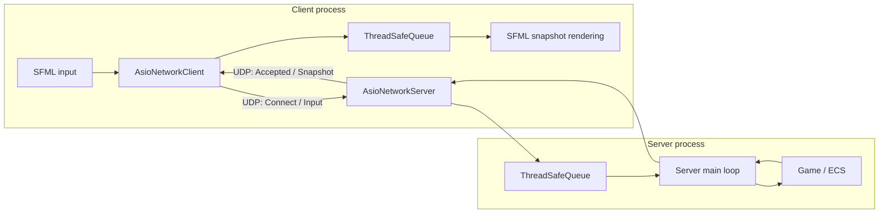

# Networking

This page explains how the current client/server networking implementation works. It focuses on the runtime
flow and the code that owns each responsibility. For exact byte offsets and message payloads, see the
[protocol specification](protocol.md). The broader subsystem map is in the [architecture overview](architecture.md).

## 1. Overview

The game uses an authoritative server over UDP. Clients send input flags; the server applies them to its game
state and broadcasts snapshots. Clients render the most recent snapshot they have received.



The server is authoritative for player positions. A client does not send a position to be trusted; it sends held
actions such as `Right` or `Shoot`. The server turns movement flags into velocity, advances the simulation,
and sends the resulting state back to every connected client.

### Follow one input through the code

For example, trace what happens when a player holds the Right arrow:

1. **Read the key.** In [`client/src/main.cpp`](../client/src/main.cpp), the SFML loop checks
  `sf::Keyboard::isKeyPressed(sf::Keyboard::Key::Right)` (or `D`) and adds `InputFlag::Right` to `inputFlags`.
  When connected, it calls `network.send(Input{inputFlags})`. Keyboard state is currently read globally, without
  a window-focus check.
2. **Queue the send.** [`AsioNetworkClient::send()`](../client/src/net/AsioNetworkClient.cpp) posts the work to
  Asio's I/O thread. `sendDatagram()` assigns a sequence number, calls `protocol::encode()`, and sends the
  resulting bytes to the server with `async_send_to()`.
3. **Encode the packet.** [`Protocol.cpp`](../common/src/Protocol.cpp) maps the `Input` variant to its message
  type and writes the header and payload. [`ByteBuffer.hpp`](../engine/include/engine/net/ByteBuffer.hpp)
  writes the fields in big-endian order.
4. **Receive and validate it.** On the server, `receive()` schedules an asynchronous UDP receive.
  `handleDatagram()` decodes the bytes and drops the datagram if validation fails. The sender's UDP endpoint
  is mapped to its player id with `findClient()`.
5. **Pass the input to the game.** For an `Input` message, the server pushes a `PlayerInput` event to its
  `ThreadSafeQueue`. In [`server/src/main.cpp`](../server/src/main.cpp), the game thread drains that queue
  and calls `Game::onInput()` for the player.
6. **Update the authoritative position.** [`Game::onInput()`](../server/src/Game.cpp) translates the Right
  flag into horizontal velocity. The fixed-timestep loop then calls `Game::update()` at 60 ticks per second;
  the movement system applies that velocity to the player's position.
7. **Broadcast the result.** `Game::snapshot()` gathers the networked entities and their current positions.
  The server main loop calls `broadcast()`, which posts the snapshot to the Asio thread. The server encodes
  it and sends it to each active client.
8. **Render the snapshot.** The client receives and decodes the server packet, then pushes the message to its
  own thread-safe queue. Back in `client/src/main.cpp`, `network.poll()` retrieves the `Snapshot`, replaces
  the displayed entity list, and SFML draws the players at the positions chosen by the server.

This separation is important: the client reports an action, the server changes the game state, and every client
renders the same server-produced snapshot. The client never tells the server, "my player is now at x = 200".

## 2. Code map

| Responsibility | Code |
|---|---|
| Message types and packet API | [`Protocol.hpp`](../common/include/common/Protocol.hpp) |
| Binary encode/decode and validation | [`Protocol.cpp`](../common/src/Protocol.cpp) |
| Big-endian byte reader/writer | [`ByteBuffer.hpp`](../engine/include/engine/net/ByteBuffer.hpp) |
| Thread-safe FIFO queues | [`ThreadSafeQueue.hpp`](../engine/include/engine/core/ThreadSafeQueue.hpp) |
| Server network contract | [`INetworkServer.hpp`](../server/src/net/INetworkServer.hpp) |
| Asio server implementation | [`AsioNetworkServer.cpp`](../server/src/net/AsioNetworkServer.cpp) |
| Client network contract | [`INetworkClient.hpp`](../client/src/net/INetworkClient.hpp) |
| Asio client implementation | [`AsioNetworkClient.cpp`](../client/src/net/AsioNetworkClient.cpp) |
| Texture loading and caching | [`ResourceManager.cpp`](../client/src/ResourceManager.cpp) |
| Server/network/game integration | [`server/src/main.cpp`](../server/src/main.cpp) |
| Client input and snapshot rendering | [`client/src/main.cpp`](../client/src/main.cpp) |

The interfaces (`INetworkServer` and `INetworkClient`) keep the game loop and renderer independent of Asio.
The concrete classes own sockets, timers, packet sequences, and their network I/O threads.

## 3. Connection lifecycle

1. The client resolves the configured host, opens an IPv4 UDP socket, and sends `Connect`.
2. The client retries `Connect` every 500 ms while it has not received an answer. It stops after an explicit
  rejection, or gives up (`ConnectionState::TimedOut`) after 10 unanswered attempts, about 5 seconds.
3. The server identifies clients by their UDP endpoint (address and port). It reuses the existing player id for
   a repeated `Connect` from the same endpoint, otherwise assigns the first free id from 0 to 3.
4. If all four slots are occupied, the server replies with `ConnectRejected(ServerFull)`. A newly accepted
   client receives `ConnectAccepted` and generates a `PlayerJoined` event for the game thread.
5. The game creates the player's entity. The server then includes that entity in its regular snapshots.
6. When the client window closes, it sends `Disconnect`. If no valid datagram arrives from a client for five
   seconds, the server times it out. Either case removes its player entity and produces an entity-destruction
   event for the other clients.

Clients send `Input` while connected, and a `Ping` every second. The server answers each `Ping` with a `Pong`:
the client measures the round-trip time from it, and the datagram also keeps the session alive when the player
sends nothing else.

The client exposes where the connection stands as a `ConnectionState`: `Connecting`, `Connected`, `Rejected`
(`ConnectRejected` received), `TimedOut` (the server never answered) and `Lost` (a connected server went silent
for five seconds). The last three are final: the graphical client shows the reason in the main menu and returns to
it. Calling `disconnect()` makes the state `Idle`, after which `connect()` can be called again.

## 4. Per-tick data flow

The server simulation runs at 60 ticks per second using `FixedTimestep`:

1. The server main thread drains `AsioNetworkServer::poll()` until the queue is empty.
2. `PlayerJoined`, `PlayerDisconnected`, and `PlayerInput` events are applied to `Game`.
3. `Game::update()` spawns an enemy every two seconds while a player is connected, advances movement, checks
  player-missile/enemy AABB collisions, updates shooting cooldowns, and removes missiles or enemies that leave
  the world. Destroying an enemy adds 100 points to the score.
4. The server creates a snapshot of networked entities and posts it for broadcast to connected clients.
5. Destruction events are broadcast after the snapshot.

The client samples the arrow keys or ZQSD and Space, sends the corresponding input flags while connected, and
drains its message queue each frame. On a `Snapshot`, it replaces its displayed entity list with the entities
in that snapshot. `ResourceManager` loads player, enemy and missile sprite sheets from `assets/`; the player id
selects a sprite row. A starfield and audio are not implemented yet.

## 5. Threads and queues

Each process has its main thread and one Asio I/O thread:

- On the server, Asio receives datagrams and handles timers/sends. The server main thread owns the game state.
- On the client, Asio receives messages and sends datagrams. The main thread owns input polling and SFML
  rendering.

`ThreadSafeQueue<T>` is the boundary between those threads. The producer pushes a decoded event or message;
the main thread calls `tryPop()` to take available items without waiting. A mutex protects the FIFO queue.
Server client-endpoint state is accessed by the Asio I/O thread; calls to `send()` and `broadcast()` post work
to that thread.

## 6. Packet handling and safety

The wire format is version 7 of the binary protocol. Integers are big-endian, positions are 16-bit quantized values
(1/16 of a world unit), and a datagram is limited to 1200 bytes. The receiver uses a fixed-size buffer and passes each
datagram to `protocol::decode()` before handling it.

The decoder rejects truncated or oversized datagrams, incorrect magic/version, unknown message types, payload
length mismatches, invalid enum values, reserved input bits, and snapshots whose entity count does not match
their payload. Invalid packets are dropped without being passed into the game. The protocol is specified in
[protocol.md](protocol.md).

## 7. Build and run

From the repository root:

```sh
cmake -S . -B build
cmake --build build -j
```

Start the server in one terminal and one or more clients in separate terminals:

```sh
./r-type_server 4242
./r-type_client 127.0.0.1 4242
```

The server accepts up to four clients. Use the arrow keys or ZQSD to move and Space to shoot. The client loads
player, enemy and missile sprites through `ResourceManager`; a starfield and audio are not implemented yet.

Run the automated tests with:

```sh
ctest --test-dir build --output-on-failure
```

Protocol round trips and malformed-packet cases are tested in [`test_protocol.cpp`](../tests/test_protocol.cpp).
Game/player lifecycle and movement are tested in [`test_game.cpp`](../tests/test_game.cpp), and queue behavior is
tested in [`test_thread_safe_queue.cpp`](../tests/test_thread_safe_queue.cpp). The UDP integration test in
[`test_network_integration.cpp`](../tests/test_network_integration.cpp) checks the four-player limit and fifth
client rejection. A local two-client session is also useful for manually checking that each client sees the same
server-owned player positions.

## 8. Current limitations

- UDP does not guarantee delivery or ordering. Snapshots are sent repeatedly; the one-off messages that matter
  (`EntityDestroyed`, `PlayerLeft`, `Disconnect`) are reliable, see section 10.
- Both sides number their packets per peer and ignore duplicated, out-of-order (`Input` and `Snapshot` only) and
  too old packets with an `engine::net::SequenceWindow` of 32 numbers; see [protocol.md](protocol.md) §3.1.
- Clients display the newest snapshot directly; interpolation, prediction, and reconciliation are not
  implemented.
- When a player leaves or times out, the server broadcasts `EntityDestroyed` for its ship and sends `PlayerLeft`
  to the remaining clients, both reliably. Reliable messages are not ordered between themselves.
- The protocol limit is 117 entities per snapshot. The server splits larger snapshots into several packets with
  the same tick, and the client merges them with `SnapshotAssembler`, ignoring older ticks and duplicates. If a
  packet of a tick is lost, that tick is displayed incomplete until the next one.
- A server answers a `Connect` of another protocol version with `ConnectRejected(VersionMismatch)`, written in the
  client's own version (see [protocol.md](protocol.md) §3.3). A client of this version that talks to an older server
  gets no answer and ends in `TimedOut`.

These are follow-up improvements, not prerequisites for the current local multiplayer prototype.

## 9. Measuring and degrading the network

### Bandwidth, latency and loss

Both sides count the datagrams and bytes they exchange (`engine::net::TrafficCounter`) and turn them into a
bandwidth once per second (`engine::net::RateMeter`).

| Where | How to read it | What it shows |
|---|---|---|
| Server | `./r-type_server 4242 --stats` prints a line every 2 seconds | clients, bytes per second out and in (and per client), totals since start, packets dropped as duplicate or outdated |
| Client | press **F3** in game, or call `INetworkClient::stats()` | smoothed ping, download and upload in KB/s, snapshot loss, packets dropped |

The client measures:

- **Ping** from its `Ping`/`Pong` exchange, smoothed so one late packet does not make the figure jump.
- **Loss** as the share of the server's packets that never arrived. The server numbers the packets it sends to a
  client one by one (§8), so a hole in the numbers is a lost packet (`engine::net::LossTracker`). A packet that
  arrives after a newer one, and a duplicated one, do not count as received.

### Simulating a bad network

[`scripts/netsim.py`](../scripts/netsim.py) is a UDP proxy that sits between the clients and the server and drops,
delays and duplicates datagrams in both directions. It needs no privileges and runs on Linux and Windows. The
jitter gives each datagram a random delay, which also reorders them.

```sh
./r-type_server 4242 --stats
python3 scripts/netsim.py --listen 5000 --server 127.0.0.1:4242 --loss 10 --delay 80 --jitter 30 --dup 2
./r-type_client 127.0.0.1 5000      # then press F3
```

Options: `--loss` and `--dup` in percent, `--delay` and `--jitter` in milliseconds, `--seed` to repeat a run.
Each client gets its own socket towards the server, so several clients can connect through the proxy.

### Example of a measurement

A scripted client (60 inputs per second while holding the fire key, one ping per second) connected for 7 seconds
to a local server. This is a single run on the loopback interface, not a benchmark of the graphical client.

| Network | Loss measured | Ping | Download |
|---|---|---|---|
| Healthy | 0.0 % (420 of 420 ticks) | under 1 ms | 12.7 KB/s |
| 20 % loss, 60 ms delay, 20 ms jitter, 3 % duplicates, each way | 20.9 % (302 of 382 ticks) | 139 ms (3 pongs) | 11.6 KB/s |

This table was measured when the server sent one snapshot per tick and loss was counted in ticks; that is the same
thing as counting packets, which is how it is counted now.

Per-client sequence numbers (§8) were checked with the same bot through `netsim.py --dup 10 --delay 30
--jitter 40` for 6 seconds: the server's `--stats` line ended with `dropped: 31 duplicate, 133 outdated`. The
outdated ones are mostly `Input` packets that the jitter delivered after a newer one; the game played normally.

These figures are the baseline for the improvements planned next (acknowledgements, delta snapshots,
interpolation): measure again after each one.

### Bandwidth of a snapshot

Quantizing positions to 16 bits (see [protocol.md](protocol.md) §4.2) was measured with a scripted client that
held the fire key and moved up and down for 40 seconds against a local server (a campaign game: 27.8 entities per
snapshot on average, 60 snapshots per second). Both runs had the same average number of entities.

| Protocol | Entity | Average snapshot packet | Downstream per client |
|---|---|---|---|
| Version 6, two 32-bit floats | 14 bytes | 415 bytes | 24.3 KB/s |
| Version 7, two 16-bit quantized positions | 10 bytes | 303 bytes | 17.8 KB/s (−27 %) |

## 10. Reliable messages

Most of the traffic is deliberately **not** reliable: an `Input` or a `Snapshot` is replaced 16 ms later, so sending
it again would only waste bandwidth. A few messages cannot be replaced, so they are sent reliably:
`EntityDestroyed`, `PlayerLeft` (server to client) and `Disconnect` (client to server).

How it works (the byte layout is in [protocol.md](protocol.md) §3.2):

1. The sender numbers the message and keeps it in an `engine::net::ReliableQueue` for that peer.
2. The receiver answers with a small `Ack` carrying the number, for the first copy and for every repeat.
3. Until the `Ack` arrives, a timer (every 50 ms) sends the message again. The delay adapts to the measured
   round-trip time and doubles after each repeat; after 12 sends the message is dropped, the peer is probably gone.
4. A message already handled is not handled twice: the receiver remembers the last 32 numbers.

Where it lives: `ReliableQueue.hpp` (engine, no socket, tested with a simulated clock), `AsioNetworkServer` (one queue
per client, `sendReliable`/`broadcastReliable`) and `AsioNetworkClient` (`sendReliable`). The server main loop
sends the game events with `broadcastReliable`. When the player closes the window, `disconnect()` sends a reliable
`Disconnect` and waits up to 500 ms for the `Ack`, so the server removes the ship at once instead of after its 5
second timeout. Both `--stats` and F3 show how many messages were **resent**. The decision is recorded in
[ADR 0009](adr/0009-reliable-messages-over-udp.md).

### Example of a measurement

A scripted client held the fire key for 10 seconds, then kept acknowledging for 6 more seconds without firing.
Every `EntityDestroyed` of the server is a reliable message; the table counts the reliable numbers the client
received, against the highest number it saw. The network was degraded with `scripts/netsim.py` (loss in each
direction, 40 ms delay, 20 ms jitter).

| Network | Reliable messages received | Missing at the end | Repeats ignored by the client | Resent by the server |
|---|---|---|---|---|
| Healthy | 39 of 39 | 0 | 0 | 0 |
| 30 % loss each way (seed 5) | 48 of 48 | 0 | 22 | 54 |
| 30 % loss each way (seed 9) | 50 of 50 | 0 | 19 | 43 |
| 50 % loss each way (seed 2) | 47 of 48 | 1 | 45 | 120 |

At 50 % loss one message was still on its way when the run ended: with the delay doubling after each repeat, a
message needs several seconds to get through at that loss rate. These are single runs, not a benchmark.

## 11. Snapshot rate and interpolation

**What changed.** The server still simulates 60 ticks per second, but it sends a snapshot only every 2 ticks (30 per
second). The client shows the world slightly in the past and moves each entity along the straight line between two
snapshots, so the motion on screen stays smooth at 60 frames per second. `r-type_server --snapshot-every N` changes
the interval (the startup line shows it); the default is `SnapshotEveryTicks` in `common/Constants.hpp`. The decision
is recorded in [ADR 0010](adr/0010-snapshot-rate-and-interpolation.md).

**How the client does it** (`common/SnapshotInterpolator.hpp`, used by `client/src/main.cpp`):

1. The packets of a tick are merged by the `SnapshotAssembler`, then handed to the interpolator.
2. The interpolator shows the world `InterpolationDelaySnapshots` (2) snapshot intervals behind the newest snapshot, so
   that it always has a snapshot on each side of the time being shown. A single lost snapshot is invisible.
3. Time is counted in server ticks. The client estimates the offset between its clock and the server's with the packet
   that arrived with the least delay, and lets that estimate creep up slowly to follow a drift of the clocks.
4. Each snapshot is **handled** (sounds, explosions, score, lives, game over) when its time comes, and the entities
   drawn are the blend of the current snapshot and the next one. What you hear and what you see therefore match.
5. Nothing is extrapolated: without a newer snapshot, the last one is held (the entities pause).

**What it costs.** The world is drawn about 2 intervals (66 ms) plus up to one interval (33 ms) after it happened,
instead of 16 ms. For a shooter this is noticeable; `--snapshot-every 1` brings the delay back to 33 + 16 ms at the
price of twice the bandwidth. The client does not predict the movement of its own ship (see the limitations).

### Bandwidth

Scripted client holding the fire key and moving up and down for 30 seconds against a local server, campaign game,
about 27 entities per snapshot, protocol version 7:

| Snapshots | Snapshots per second | Average packet | Downstream per client |
|---|---|---|---|
| Every tick (`--snapshot-every 1`) | 60 | 300 bytes | 17.6 KB/s |
| Every 2 ticks (default) | 30 | 287 bytes | 8.4 KB/s |
| Every 3 ticks (`--snapshot-every 3`) | 20 | 298 bytes | 5.8 KB/s |

With the two changes together (16-bit positions and 30 snapshots per second) a client receives **8.4 KB/s instead of
24.3 KB/s (−65 %)**. These are single runs of a game with random enemy spawns, not a benchmark.

### Smoothness

A moving entity (400 units per second, so 6.67 units per tick) is sent every 2 ticks; the network delays each snapshot
by 40 ms plus a random jitter. The screen is drawn 60 times per second. The table compares the largest jump of the
entity from one frame to the next when each snapshot is drawn on arrival, and with the interpolator (it should be 6.67):

| Jitter | Largest jump per frame, drawn on arrival | Largest jump per frame, interpolated |
|---|---|---|
| 0 ms | 13.3 | 6.7 |
| 15 ms | 13.3 | 7.1 |
| 30 ms | 26.7 | 8.4 |

The average distance from the real speed drops from 6.85 to 0.09 at 30 ms of jitter. This simulation is also a unit
test (`test_snapshot_interpolator.cpp`).

### Delta snapshots: why not

Sending only what changed since the last snapshot the client acknowledged was evaluated and not adopted: on a real
game 98 % of the entities move at every tick, and with the round-trip delay of a real network the movement since the
acknowledged snapshot no longer fits in a small number. See [ADR 0011](adr/0011-delta-snapshots-not-adopted.md).

---

# Version française

Cette page explique le fonctionnement actuel du réseau client-serveur et le rôle de chaque partie du code.
Pour connaître les octets exacts de chaque paquet, consultez la [spécification du protocole](protocol.md).
Pour la vue générale des sous-systèmes, consultez la [vue d’architecture](architecture.md).

## 1. Vue d’ensemble

Le jeu utilise un serveur autoritaire et communique par UDP. Les clients envoient les actions des joueurs ; le
serveur les applique à l’état du jeu et diffuse régulièrement des snapshots. Chaque client affiche le dernier
snapshot reçu.

Le serveur fait autorité sur les positions. Un client n’envoie pas une position que le serveur devrait accepter :
il envoie des actions maintenues, comme `Right` ou `Shoot`. Le serveur transforme les flags de déplacement en
vitesse, fait avancer la simulation et renvoie le résultat aux clients connectés.

### Suivre une commande dans le code

Voici le trajet d’un joueur qui maintient la flèche droite :

1. **Lecture de la touche.** Dans [`client/src/main.cpp`](../client/src/main.cpp), la boucle SFML vérifie
  `sf::Keyboard::isKeyPressed(sf::Keyboard::Key::Right)` (ou `D`) et ajoute `InputFlag::Right` à `inputFlags`. Si le
  client est connecté, il appelle `network.send(Input{inputFlags})`. Actuellement, l’état du clavier est lu
  globalement, sans vérifier quelle fenêtre a le focus.
2. **Mise en file de l’envoi.** [`AsioNetworkClient::send()`](../client/src/net/AsioNetworkClient.cpp) poste le
  travail au thread d’E/S d’Asio. `sendDatagram()` attribue un numéro de séquence, appelle
  `protocol::encode()`, puis envoie les octets au serveur avec `async_send_to()`.
3. **Encodage du paquet.** [`Protocol.cpp`](../common/src/Protocol.cpp) associe la variante `Input` à son type
  de message et écrit l’en-tête et le contenu. [`ByteBuffer.hpp`](../engine/include/engine/net/ByteBuffer.hpp)
  écrit les champs en big-endian.
4. **Réception et validation.** Côté serveur, `receive()` programme une réception UDP asynchrone.
  `handleDatagram()` décode les octets et ignore le datagramme si la validation échoue. `findClient()` associe
  l’adresse UDP de l’expéditeur à son identifiant de joueur.
5. **Transmission au jeu.** Pour un message `Input`, le serveur ajoute un événement `PlayerInput` à sa
  `ThreadSafeQueue`. Dans [`server/src/main.cpp`](../server/src/main.cpp), le thread du jeu vide cette file et
  appelle `Game::onInput()` pour le joueur concerné.
6. **Mise à jour de la position autoritaire.** [`Game::onInput()`](../server/src/Game.cpp) transforme le flag
  `Right` en vitesse horizontale. La boucle à pas fixe appelle ensuite `Game::update()` 60 fois par seconde ;
  le système de déplacement applique cette vitesse à la position du joueur.
7. **Diffusion du résultat.** `Game::snapshot()` rassemble les entités réseau et leurs positions actuelles. La
  boucle serveur appelle `broadcast()`, qui poste le snapshot au thread Asio. Celui-ci l’encode et l’envoie à
  chaque client actif.
8. **Affichage du snapshot.** Le client reçoit et décode le paquet, puis place le message dans sa file
  thread-safe. De retour dans `client/src/main.cpp`, `network.poll()` récupère le `Snapshot`, remplace la liste
  des entités affichées, puis SFML dessine les joueurs aux positions calculées par le serveur.

Cette séparation est importante : le client signale une action, le serveur modifie l’état du jeu, puis tous les
clients affichent le snapshot produit par le serveur. Le client ne dit jamais au serveur : « mon joueur est
maintenant à x = 200 ».

## 2. Fichiers concernés

| Responsabilité | Fichier |
|---|---|
| Types de messages et API des paquets | [`Protocol.hpp`](../common/include/common/Protocol.hpp) |
| Encodage, décodage et validation binaire | [`Protocol.cpp`](../common/src/Protocol.cpp) |
| Lecture et écriture big-endian | [`ByteBuffer.hpp`](../engine/include/engine/net/ByteBuffer.hpp) |
| Files FIFO thread-safe | [`ThreadSafeQueue.hpp`](../engine/include/engine/core/ThreadSafeQueue.hpp) |
| Contrat réseau serveur | [`INetworkServer.hpp`](../server/src/net/INetworkServer.hpp) |
| Implémentation serveur avec Asio | [`AsioNetworkServer.cpp`](../server/src/net/AsioNetworkServer.cpp) |
| Contrat réseau client | [`INetworkClient.hpp`](../client/src/net/INetworkClient.hpp) |
| Implémentation client avec Asio | [`AsioNetworkClient.cpp`](../client/src/net/AsioNetworkClient.cpp) |
| Chargement et cache des textures | [`ResourceManager.cpp`](../client/src/ResourceManager.cpp) |
| Intégration réseau et jeu côté serveur | [`server/src/main.cpp`](../server/src/main.cpp) |
| Entrées client et affichage des snapshots | [`client/src/main.cpp`](../client/src/main.cpp) |

Les interfaces `INetworkServer` et `INetworkClient` séparent le jeu et le rendu de la bibliothèque Asio. Les
classes concrètes gèrent les sockets, les timers, les numéros de séquence et leurs threads réseau.

## 3. Cycle de connexion

1. Le client résout l’hôte configuré, ouvre une socket UDP IPv4 et envoie `Connect`.
2. Tant qu’il n’a pas reçu de réponse, le client réessaie `Connect` toutes les 500 ms. Il arrête les tentatives
  après un refus explicite.
3. Le serveur identifie les clients par leur adresse et leur port UDP. Une nouvelle connexion reçoit le premier
  identifiant libre entre 0 et 3 ; une nouvelle demande provenant du même endpoint retrouve l’identifiant déjà
  attribué.
4. Si les quatre places sont prises, le serveur répond `ConnectRejected(ServerFull)`. Sinon, il envoie
  `ConnectAccepted` et ajoute un événement `PlayerJoined` à la file du thread de jeu.
5. Le jeu crée l’entité du joueur et le serveur l’inclut dans ses snapshots réguliers.
6. À la fermeture de la fenêtre, le client envoie `Disconnect`. Si aucun datagramme valide n’est reçu d’un client
  pendant cinq secondes, le serveur le considère comme inactif. Dans les deux cas, son entité est supprimée et
  un événement de destruction est envoyé aux autres clients.

Les clients envoient des messages `Input` une fois connectés, et un `Ping` par seconde. Le serveur répond à chaque
`Ping` par un `Pong` : le client en déduit le temps d’aller-retour, et ce datagramme maintient aussi la session
active quand le joueur n’envoie rien d’autre.

Le client expose l’état de la connexion sous forme de `ConnectionState` : `Connecting`, `Connected`, `Rejected`
(`ConnectRejected` reçu), `TimedOut` (le serveur n’a jamais répondu) et `Lost` (un serveur connecté s’est tu
pendant cinq secondes). Les trois derniers sont définitifs : le client graphique affiche la raison dans le menu
principal et y retourne. `disconnect()` remet l’état à `Idle`, et `connect()` peut alors être rappelé.

## 4. Déroulement d’un tick

La simulation serveur tourne à 60 ticks par seconde avec `FixedTimestep` :

1. Le thread principal vide `AsioNetworkServer::poll()` jusqu’à ce que la file soit vide.
2. Les événements `PlayerJoined`, `PlayerDisconnected` et `PlayerInput` sont appliqués à `Game`.
3. `Game::update()` fait apparaître un ennemi toutes les deux secondes lorsqu’un joueur est connecté, met à jour
  les déplacements, teste les collisions AABB entre missiles joueurs et ennemis, gère la cadence de tir et
  supprime les missiles ou ennemis sortis du monde. Détruire un ennemi ajoute 100 points au score.
4. Le serveur construit un snapshot des entités réseau et demande sa diffusion aux clients connectés.
5. Les événements de destruction sont diffusés après le snapshot.

Le client lit les flèches ou ZQSD et Espace, envoie les flags correspondants quand il est connecté, puis vide sa
file de messages à chaque image. Lorsqu’il reçoit un `Snapshot`, il remplace la liste des entités affichées.
`ResourceManager` charge les sprites des joueurs, ennemis et missiles depuis `assets/` ; l’identifiant du joueur
choisit une ligne de sprite. Le starfield et l’audio ne sont pas encore implémentés.

## 5. Threads et files

Chaque programme possède son thread principal et un thread d’E/S Asio :

- Côté serveur, Asio reçoit les datagrammes et gère les timers et les envois. Le thread principal serveur
  possède l’état du jeu.
- Côté client, Asio reçoit les messages et envoie les datagrammes. Le thread principal gère les entrées et le
  rendu SFML.

`ThreadSafeQueue<T>` relie ces threads. Le producteur ajoute un événement ou un message décodé ; le thread
principal appelle `tryPop()` pour récupérer les éléments disponibles sans attendre. Un mutex protège la file
FIFO. L’état des endpoints clients appartient au thread Asio serveur ; `send()` et `broadcast()` lui postent le
travail à effectuer.

## 6. Paquets et sécurité

Le format transmis sur le réseau est la version 7 du protocole binaire. Les entiers sont en big-endian, les
positions sont des valeurs quantifiées sur 16 bits (1/16 d’unité du monde) et chaque datagramme est limité à
1 200 octets. Le récepteur
utilise un buffer de taille fixe et passe chaque datagramme à `protocol::decode()` avant de le traiter.

Le décodeur rejette les datagrammes tronqués ou trop volumineux, les signatures ou versions incorrectes, les
types de messages inconnus, les tailles de contenu incohérentes, les valeurs d’énumération invalides, les bits
réservés des entrées et les snapshots dont le nombre d’entités ne correspond pas à leur contenu. Un paquet
invalide n’est pas transmis au jeu. La description complète se trouve dans [protocol.md](protocol.md).

## 7. Compiler et lancer

Depuis la racine du dépôt :

```sh
cmake -S . -B build
cmake --build build -j
```

Lancer le serveur dans un terminal puis un ou plusieurs clients dans des terminaux séparés :

```sh
./r-type_server 4242
./r-type_client 127.0.0.1 4242
```

Le serveur accepte quatre clients au maximum. Les flèches ou ZQSD déplacent le joueur et Espace tire. Le client
charge les sprites des joueurs, ennemis et missiles avec `ResourceManager`. Le starfield et l’audio ne sont pas
encore implémentés.

Lancer les tests automatisés avec :

```sh
ctest --test-dir build --output-on-failure
```

Les échanges aller-retour du protocole et les paquets malformés sont testés dans
[`test_protocol.cpp`](../tests/test_protocol.cpp). Le cycle de vie des joueurs et le déplacement sont testés
dans [`test_game.cpp`](../tests/test_game.cpp), et la file dans
[`test_thread_safe_queue.cpp`](../tests/test_thread_safe_queue.cpp). Le test UDP d’intégration dans
[`test_network_integration.cpp`](../tests/test_network_integration.cpp) vérifie la limite de quatre joueurs et le
refus du cinquième. Une session locale avec deux clients permet aussi de vérifier que chacun voit les positions
des joueurs calculées par le serveur.

## 8. Limites actuelles

- UDP ne garantit ni la livraison ni l’ordre des paquets. Les snapshots sont renvoyés régulièrement ; les messages
  ponctuels qui comptent (`EntityDestroyed`, `PlayerLeft`, `Disconnect`) sont fiables, voir la section 10.
- Chaque côté numérote ses paquets par interlocuteur et ignore les paquets dupliqués, arrivés dans le désordre
  (`Input` et `Snapshot` seulement) ou trop anciens, grâce à une `engine::net::SequenceWindow` de 32 numéros ;
  voir [protocol.md](protocol.md) §3.1.
- Les clients affichent directement le snapshot le plus récent ; l’interpolation, la prédiction et la
  réconciliation ne sont pas implémentées.
- Lorsqu’un joueur part ou expire, le serveur diffuse `EntityDestroyed` pour son vaisseau et envoie `PlayerLeft`
  aux clients restants, tous deux de façon fiable. Les messages fiables ne sont pas ordonnés entre eux.
- Un snapshot est limité à 117 entités. Le serveur découpe les snapshots plus grands en plusieurs paquets de même
  tick, et le client les fusionne avec `SnapshotAssembler` en ignorant les ticks plus anciens et les doublons. Si
  un paquet d’un tick est perdu, ce tick s’affiche incomplet jusqu’au suivant.
- Un serveur répond à un `Connect` d’une autre version du protocole par `ConnectRejected(VersionMismatch)`, écrit
  dans la version du client (voir [protocol.md](protocol.md) §3.3). Un client de cette version qui parle à un
  serveur plus ancien n’obtient pas de réponse et finit en `TimedOut`.

Ces améliorations pourront être faites plus tard ; elles ne sont pas nécessaires au prototype multijoueur local
actuel.

## 9. Mesurer et dégrader le réseau

### Bande passante, latence et pertes

Chaque côté compte les datagrammes et les octets échangés (`engine::net::TrafficCounter`) et en tire un débit une
fois par seconde (`engine::net::RateMeter`).

| Où | Comment le lire | Ce que l’on voit |
|---|---|---|
| Serveur | `./r-type_server 4242 --stats` affiche une ligne toutes les 2 secondes | clients, octets par seconde envoyés et reçus (et par client), totaux depuis le démarrage, paquets écartés (doublons, trop tard) |
| Client | touche **F3** en jeu, ou `INetworkClient::stats()` | ping lissé, débit descendant et montant en Ko/s, pertes de snapshots, paquets écartés |

Le client mesure :

- le **ping**, grâce à l’échange `Ping`/`Pong`, lissé pour qu’un paquet en retard ne fasse pas sauter la valeur ;
- les **pertes**, c’est-à-dire la part des paquets du serveur qui ne sont jamais arrivés. Le serveur numérote un à un
  les paquets qu’il envoie à un client (§8) : un trou dans les numéros est un paquet perdu
  (`engine::net::LossTracker`). Un paquet arrivé après un plus récent, ou dupliqué, n’est pas compté comme reçu.

### Simuler un mauvais réseau

[`scripts/netsim.py`](../scripts/netsim.py) est un proxy UDP placé entre les clients et le serveur : il perd,
retarde et duplique des datagrammes dans les deux sens. Il ne demande aucun privilège et fonctionne sous Linux et
Windows. La gigue donne un délai aléatoire à chaque datagramme, ce qui les désordonne aussi.

```sh
./r-type_server 4242 --stats
python3 scripts/netsim.py --listen 5000 --server 127.0.0.1:4242 --loss 10 --delay 80 --jitter 30 --dup 2
./r-type_client 127.0.0.1 5000      # puis appuyer sur F3
```

Options : `--loss` et `--dup` en pourcentage, `--delay` et `--jitter` en millisecondes, `--seed` pour rejouer un
essai. Chaque client a sa propre socket vers le serveur : plusieurs clients peuvent passer par le proxy.

### Exemple de mesure

Un client scripté (60 inputs par seconde en maintenant le tir, un ping par seconde) s’est connecté 7 secondes à un
serveur local. C’est un seul essai sur l’interface locale, pas un benchmark du client graphique.

| Réseau | Pertes mesurées | Ping | Débit descendant |
|---|---|---|---|
| Sain | 0,0 % (420 ticks sur 420) | moins de 1 ms | 12,7 Ko/s |
| 20 % de perte, 60 ms de délai, 20 ms de gigue, 3 % de doublons, dans chaque sens | 20,9 % (302 ticks sur 382) | 139 ms (3 pongs) | 11,6 Ko/s |

Les numéros de séquence par client (§8) ont été vérifiés avec le même bot via `netsim.py --dup 10 --delay 30
--jitter 40` pendant 6 secondes : la ligne `--stats` du serveur se terminait par
`dropped: 31 duplicate, 133 outdated`. Les paquets périmés sont surtout des `Input` que la gigue a livrés après un
plus récent ; la partie s’est déroulée normalement.

Ces valeurs servent de référence pour les améliorations prévues (acquittements, snapshots différentiels,
interpolation) : il faudra mesurer à nouveau après chacune.

### Débit d’un snapshot

La quantification des positions sur 16 bits (voir [protocol.md](protocol.md) §4.2) a été mesurée avec un client
scripté qui maintenait le tir et montait et descendait pendant 40 secondes contre un serveur local (une partie de
campagne : 27,8 entités par snapshot en moyenne, 60 snapshots par seconde). Les deux essais avaient le même nombre
moyen d’entités.

| Protocole | Entité | Paquet snapshot moyen | Débit descendant par client |
|---|---|---|---|
| Version 6, deux flottants de 32 bits | 14 octets | 415 octets | 24,3 Ko/s |
| Version 7, deux positions quantifiées sur 16 bits | 10 octets | 303 octets | 17,8 Ko/s (−27 %) |

## 10. Messages fiables

La plus grande partie du trafic n’est volontairement **pas** fiable : un `Input` ou un `Snapshot` est remplacé 16 ms
plus tard, le renvoyer gaspillerait de la bande passante. Quelques messages ne peuvent pas être remplacés, ils sont
donc envoyés de façon fiable : `EntityDestroyed`, `PlayerLeft` (serveur vers client) et `Disconnect` (client vers
serveur).

Fonctionnement (le détail des octets est dans [protocol.md](protocol.md) §3.2) :

1. L’émetteur numérote le message et le garde dans une `engine::net::ReliableQueue` propre à cet interlocuteur.
2. Le récepteur répond par un petit `Ack` portant le numéro, pour la première copie et pour chaque répétition.
3. Tant que l’`Ack` n’est pas arrivé, un timer (toutes les 50 ms) renvoie le message. Le délai s’adapte au temps
   d’aller-retour mesuré et double à chaque répétition ; après 12 envois le message est abandonné, l’interlocuteur est
   sans doute parti.
4. Un message déjà traité ne l’est pas deux fois : le récepteur retient les 32 derniers numéros.

Où cela se trouve : `ReliableQueue.hpp` (moteur, sans socket, testé avec une horloge simulée), `AsioNetworkServer`
(une file par client, `sendReliable`/`broadcastReliable`) et `AsioNetworkClient` (`sendReliable`). La boucle du
serveur envoie les événements du jeu avec `broadcastReliable`. Quand le joueur ferme la fenêtre, `disconnect()`
envoie un `Disconnect` fiable et attend jusqu’à 500 ms l’`Ack`, si bien que le serveur retire le vaisseau tout de
suite et pas après son délai de 5 secondes. `--stats` et F3 affichent le nombre de messages **renvoyés**.

### Exemple de mesure

Le même client scripté que dans la section 9 a maintenu le tir 10 secondes, puis a continué d’acquitter 6 secondes
sans tirer. Chaque `EntityDestroyed` du serveur est un message fiable ; le tableau compte les numéros fiables reçus
par le client, par rapport au plus haut numéro vu.

| Réseau | Messages fiables reçus | Manquants à la fin | Répétitions ignorées par le client | Renvoyés par le serveur |
|---|---|---|---|---|
| Sain | 39 sur 39 | 0 | 0 | 0 |
| 30 % de perte dans chaque sens, 40 ms de délai, 20 ms de gigue (graine 5) | 48 sur 48 | 0 | 22 | 54 |
| 30 % de perte dans chaque sens (graine 9) | 50 sur 50 | 0 | 19 | 43 |
| 50 % de perte dans chaque sens (graine 2) | 47 sur 48 | 1 | 45 | 120 |

À 50 % de perte, un message était encore en route à la fin de l’essai : comme le délai double à chaque répétition,
un message met plusieurs secondes à passer à ce taux de perte. Ce sont des essais uniques, pas un benchmark.

## 11. Fréquence des snapshots et interpolation

**Ce qui change.** Le serveur simule toujours 60 ticks par seconde, mais il n’envoie un snapshot que tous les 2 ticks
(30 par seconde). Le client affiche le monde légèrement dans le passé et déplace chaque entité en ligne droite entre
deux snapshots, si bien que le mouvement reste fluide à 60 images par seconde. `r-type_server --snapshot-every N`
change l’intervalle (la ligne de démarrage l’affiche) ; la valeur par défaut est `SnapshotEveryTicks` dans
`common/Constants.hpp`. La décision est consignée dans l’[ADR 0010](adr/0010-snapshot-rate-and-interpolation.md).

**Comment le client procède** (`common/SnapshotInterpolator.hpp`, utilisé par `client/src/main.cpp`) :

1. Les paquets d’un tick sont fusionnés par le `SnapshotAssembler`, puis confiés à l’interpolateur.
2. L’interpolateur affiche le monde `InterpolationDelaySnapshots` (2) intervalles de snapshot derrière le snapshot le
   plus récent, pour avoir toujours un snapshot de chaque côté de l’instant affiché. Un snapshot perdu seul est
   invisible.
3. Le temps est compté en ticks du serveur. Le client estime l’écart entre son horloge et celle du serveur avec le
   paquet arrivé avec le moins de retard, et laisse cette estimation remonter lentement pour suivre une dérive des
   horloges.
4. Chaque snapshot est **traité** (sons, explosions, score, vies, fin de partie) quand son heure arrive, et les
   entités dessinées sont le mélange du snapshot courant et du suivant. Ce que l’on entend et ce que l’on voit
   concordent donc.
5. Rien n’est extrapolé : sans snapshot plus récent, le dernier est conservé (les entités marquent une pause).

**Ce que cela coûte.** Le monde est dessiné environ 2 intervalles (66 ms) plus jusqu’à un intervalle (33 ms) après
l’événement, au lieu de 16 ms. Pour un jeu de tir c’est perceptible ; `--snapshot-every 1` ramène le retard à
33 + 16 ms au prix d’une bande passante double. Le client ne prédit pas le mouvement de son propre vaisseau (voir les
limites).

### Bande passante

Client scripté qui maintient le tir et monte et descend pendant 30 secondes contre un serveur local, partie de
campagne, environ 27 entités par snapshot, protocole version 7 :

| Snapshots | Snapshots par seconde | Paquet moyen | Débit descendant par client |
|---|---|---|---|
| À chaque tick (`--snapshot-every 1`) | 60 | 300 octets | 17,6 Ko/s |
| Tous les 2 ticks (défaut) | 30 | 287 octets | 8,4 Ko/s |
| Tous les 3 ticks (`--snapshot-every 3`) | 20 | 298 octets | 5,8 Ko/s |

Avec les deux changements ensemble (positions sur 16 bits et 30 snapshots par seconde), un client reçoit **8,4 Ko/s
au lieu de 24,3 Ko/s (−65 %)**. Ce sont des essais uniques d’une partie aux apparitions d’ennemis aléatoires, pas un
benchmark.

### Fluidité

Une entité en mouvement (400 unités par seconde, soit 6,67 unités par tick) est envoyée tous les 2 ticks ; le réseau
retarde chaque snapshot de 40 ms plus une gigue aléatoire. L’écran est dessiné 60 fois par seconde. Le tableau compare
le plus grand saut de l’entité d’une image à la suivante quand chaque snapshot est dessiné dès son arrivée, et avec
l’interpolateur (il devrait être de 6,67) :

| Gigue | Plus grand saut par image, dessin à l’arrivée | Plus grand saut par image, interpolé |
|---|---|---|
| 0 ms | 13,3 | 6,7 |
| 15 ms | 13,3 | 7,1 |
| 30 ms | 26,7 | 8,4 |

L’écart moyen à la vitesse réelle passe de 6,85 à 0,09 avec 30 ms de gigue. Cette simulation est aussi un test
unitaire (`test_snapshot_interpolator.cpp`).

### Snapshots différentiels : pourquoi pas

Envoyer seulement ce qui a changé depuis le dernier snapshot acquitté par le client a été évalué et n’a pas été
retenu : dans une vraie partie 98 % des entités bougent à chaque tick, et avec le temps d’aller-retour d’un vrai
réseau le mouvement depuis le snapshot acquitté ne tient plus dans un petit nombre. Voir l’[ADR
0011](adr/0011-delta-snapshots-not-adopted.md).
