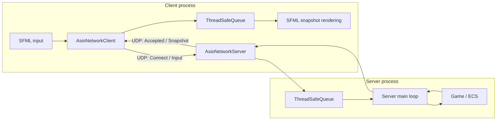

# Networking

This page explains how the current client/server networking implementation works. It focuses on the runtime
flow and the code that owns each responsibility. For exact byte offsets and message payloads, see the
[protocol specification](protocol.md). The broader subsystem map is in the [architecture overview](architecture.md).

## 1. Overview

The game uses an authoritative server over UDP. Clients send input flags; the server applies them to its game
state and broadcasts snapshots. Clients render the most recent snapshot they have received.



The server is authoritative for player positions. A client does not send a position to be trusted; it sends held
actions such as `Right` or `Shoot`. The server turns movement flags into velocity, advances the simulation,
and sends the resulting state back to every connected client.

### Follow one input through the code

For example, trace what happens when a player holds the Right arrow:

1. **Read the key.** In [`client/src/main.cpp`](../client/src/main.cpp), the SFML loop checks
  `sf::Keyboard::isKeyPressed(sf::Keyboard::Key::Right)` and adds `InputFlag::Right` to `inputFlags`. When
  connected, it calls `network.send(Input{inputFlags})`. Keyboard state is currently read globally, without a
  window-focus check.
2. **Queue the send.** [`AsioNetworkClient::send()`](../client/src/net/AsioNetworkClient.cpp) posts the work to
  Asio's I/O thread. `sendDatagram()` assigns a sequence number, calls `protocol::encode()`, and sends the
  resulting bytes to the server with `async_send_to()`.
3. **Encode the packet.** [`Protocol.cpp`](../common/src/Protocol.cpp) maps the `Input` variant to its message
  type and writes the header and payload. [`ByteBuffer.hpp`](../engine/include/engine/net/ByteBuffer.hpp)
  writes the fields in big-endian order.
4. **Receive and validate it.** On the server, `receive()` schedules an asynchronous UDP receive.
  `handleDatagram()` decodes the bytes and drops the datagram if validation fails. The sender's UDP endpoint
  is mapped to its player id with `findClient()`.
5. **Pass the input to the game.** For an `Input` message, the server pushes a `PlayerInput` event to its
  `ThreadSafeQueue`. In [`server/src/main.cpp`](../server/src/main.cpp), the game thread drains that queue
  and calls `Game::onInput()` for the player.
6. **Update the authoritative position.** [`Game::onInput()`](../server/src/Game.cpp) translates the Right
  flag into horizontal velocity. The fixed-timestep loop then calls `Game::update()` at 60 ticks per second;
  the movement system applies that velocity to the player's position.
7. **Broadcast the result.** `Game::snapshot()` gathers the networked entities and their current positions.
  The server main loop calls `broadcast()`, which posts the snapshot to the Asio thread. The server encodes
  it and sends it to each active client.
8. **Render the snapshot.** The client receives and decodes the server packet, then pushes the message to its
  own thread-safe queue. Back in `client/src/main.cpp`, `network.poll()` retrieves the `Snapshot`, replaces
  the displayed entity list, and SFML draws the players at the positions chosen by the server.

This separation is important: the client reports an action, the server changes the game state, and every client
renders the same server-produced snapshot. The client never tells the server, "my player is now at x = 200".

## 2. Code map

| Responsibility | Code |
|---|---|
| Message types and packet API | [`Protocol.hpp`](../common/include/common/Protocol.hpp) |
| Binary encode/decode and validation | [`Protocol.cpp`](../common/src/Protocol.cpp) |
| Big-endian byte reader/writer | [`ByteBuffer.hpp`](../engine/include/engine/net/ByteBuffer.hpp) |
| Thread-safe FIFO queues | [`ThreadSafeQueue.hpp`](../engine/include/engine/core/ThreadSafeQueue.hpp) |
| Server network contract | [`INetworkServer.hpp`](../server/src/net/INetworkServer.hpp) |
| Asio server implementation | [`AsioNetworkServer.cpp`](../server/src/net/AsioNetworkServer.cpp) |
| Client network contract | [`INetworkClient.hpp`](../client/src/net/INetworkClient.hpp) |
| Asio client implementation | [`AsioNetworkClient.cpp`](../client/src/net/AsioNetworkClient.cpp) |
| Server/network/game integration | [`server/src/main.cpp`](../server/src/main.cpp) |
| Client input and snapshot rendering | [`client/src/main.cpp`](../client/src/main.cpp) |

The interfaces (`INetworkServer` and `INetworkClient`) keep the game loop and renderer independent of Asio.
The concrete classes own sockets, timers, packet sequences, and their network I/O threads.

## 3. Connection lifecycle

1. The client resolves the configured host, opens an IPv4 UDP socket, and sends `Connect`.
2. The client retries `Connect` every 500 ms while it has not received an answer. It stops retrying after an
  explicit rejection.
3. The server identifies clients by their UDP endpoint (address and port). It reuses the existing player id for
   a repeated `Connect` from the same endpoint, otherwise assigns the first free id from 0 to 3.
4. If all four slots are occupied, the server replies with `ConnectRejected(ServerFull)`. A newly accepted
   client receives `ConnectAccepted` and generates a `PlayerJoined` event for the game thread.
5. The game creates the player's entity. The server then includes that entity in its regular snapshots.
6. When the client window closes, it sends `Disconnect`. If no valid datagram arrives from a client for five
   seconds, the server times it out. Either case removes its player entity and produces an entity-destruction
   event for the other clients.

Clients send `Input` while connected. The server also responds to `Ping` with `Pong`; the graphical client does
not currently send pings.

## 4. Per-tick data flow

The server simulation runs at 60 ticks per second using `FixedTimestep`:

1. The server main thread drains `AsioNetworkServer::poll()` until the queue is empty.
2. `PlayerJoined`, `PlayerDisconnected`, and `PlayerInput` events are applied to `Game`.
3. `Game::update()` advances registered ECS systems. Currently this includes movement, shooting cooldowns,
   and removal of missiles that leave the world.
4. The server creates a snapshot of networked entities and posts it for broadcast to connected clients.
5. Destruction events are broadcast after the snapshot.

The client samples the arrow keys and Space, sends the corresponding input flags while connected, and drains its
message queue each frame. On a `Snapshot`, it replaces its displayed entity list with the entities in that
snapshot. Player ids select different colors; other entity types currently use a simple yellow rectangle.

## 5. Threads and queues

Each process has its main thread and one Asio I/O thread:

- On the server, Asio receives datagrams and handles timers/sends. The server main thread owns the game state.
- On the client, Asio receives messages and sends datagrams. The main thread owns input polling and SFML
  rendering.

`ThreadSafeQueue<T>` is the boundary between those threads. The producer pushes a decoded event or message;
the main thread calls `tryPop()` to take available items without waiting. A mutex protects the FIFO queue.
Server client-endpoint state is accessed by the Asio I/O thread; calls to `send()` and `broadcast()` post work
to that thread.

## 6. Packet handling and safety

The wire format is version 1 of the binary protocol. Integers are big-endian, floats are sent as IEEE-754
32-bit values, and a datagram is limited to 1200 bytes. The receiver uses a fixed-size buffer and passes each
datagram to `protocol::decode()` before handling it.

The decoder rejects truncated or oversized datagrams, incorrect magic/version, unknown message types, payload
length mismatches, invalid enum values, reserved input bits, and snapshots whose entity count does not match
their payload. Invalid packets are dropped without being passed into the game. The protocol is specified in
[protocol.md](protocol.md).

## 7. Build and run

From the repository root:

```sh
cmake -S . -B build
cmake --build build -j
```

Start the server in one terminal and one or more clients in separate terminals:

```sh
./r-type_server 4242
./r-type_client 127.0.0.1 4242
```

The server accepts up to four clients. Use the arrow keys to move and Space to shoot. The current client uses
basic colored rectangles; enemies, a starfield, sprites, and audio are not part of the networking implementation.

Run the automated tests with:

```sh
ctest --test-dir build --output-on-failure
```

Protocol round trips and malformed-packet cases are tested in [`test_protocol.cpp`](../tests/test_protocol.cpp).
Game/player lifecycle and movement are tested in [`test_game.cpp`](../tests/test_game.cpp), and queue behavior is
tested in [`test_thread_safe_queue.cpp`](../tests/test_thread_safe_queue.cpp). A local two-client session is
also useful for manually checking that each client sees the same server-owned player positions.

## 8. Current limitations

- UDP does not guarantee delivery or ordering. Snapshots are sent repeatedly, but one-off events are not
  acknowledged or retransmitted.
- The sequence number is included in packets, but receivers do not yet filter duplicate or out-of-order packets.
- Clients display the newest snapshot directly; interpolation, prediction, and reconciliation are not
  implemented.
- The current server removes a departed player's entity and broadcasts `EntityDestroyed`. The protocol also
  defines `PlayerLeft`, but the server does not currently send that message.
- The protocol limit is 84 entities per snapshot. The runtime does not split larger snapshots; encoding one
  throws if the limit is exceeded. The graphical client also does not reassemble multiple snapshots for one tick.
- The protocol specification describes `VersionMismatch` rejection and stale-entity removal; those behaviors
  are not currently implemented by the runtime.

These are follow-up improvements, not prerequisites for the current local multiplayer prototype.

---

# Version française

Cette page explique le fonctionnement actuel du réseau client-serveur et le rôle de chaque partie du code.
Pour connaître les octets exacts de chaque paquet, consultez la [spécification du protocole](protocol.md).
Pour la vue générale des sous-systèmes, consultez la [vue d’architecture](architecture.md).

## 1. Vue d’ensemble

Le jeu utilise un serveur autoritaire et communique par UDP. Les clients envoient les actions des joueurs ; le
serveur les applique à l’état du jeu et diffuse régulièrement des snapshots. Chaque client affiche le dernier
snapshot reçu.

Le serveur fait autorité sur les positions. Un client n’envoie pas une position que le serveur devrait accepter :
il envoie des actions maintenues, comme `Right` ou `Shoot`. Le serveur transforme les flags de déplacement en
vitesse, fait avancer la simulation et renvoie le résultat aux clients connectés.

### Suivre une commande dans le code

Voici le trajet d’un joueur qui maintient la flèche droite :

1. **Lecture de la touche.** Dans [`client/src/main.cpp`](../client/src/main.cpp), la boucle SFML vérifie
  `sf::Keyboard::isKeyPressed(sf::Keyboard::Key::Right)` et ajoute `InputFlag::Right` à `inputFlags`. Si le
  client est connecté, il appelle `network.send(Input{inputFlags})`. Actuellement, l’état du clavier est lu
  globalement, sans vérifier quelle fenêtre a le focus.
2. **Mise en file de l’envoi.** [`AsioNetworkClient::send()`](../client/src/net/AsioNetworkClient.cpp) poste le
  travail au thread d’E/S d’Asio. `sendDatagram()` attribue un numéro de séquence, appelle
  `protocol::encode()`, puis envoie les octets au serveur avec `async_send_to()`.
3. **Encodage du paquet.** [`Protocol.cpp`](../common/src/Protocol.cpp) associe la variante `Input` à son type
  de message et écrit l’en-tête et le contenu. [`ByteBuffer.hpp`](../engine/include/engine/net/ByteBuffer.hpp)
  écrit les champs en big-endian.
4. **Réception et validation.** Côté serveur, `receive()` programme une réception UDP asynchrone.
  `handleDatagram()` décode les octets et ignore le datagramme si la validation échoue. `findClient()` associe
  l’adresse UDP de l’expéditeur à son identifiant de joueur.
5. **Transmission au jeu.** Pour un message `Input`, le serveur ajoute un événement `PlayerInput` à sa
  `ThreadSafeQueue`. Dans [`server/src/main.cpp`](../server/src/main.cpp), le thread du jeu vide cette file et
  appelle `Game::onInput()` pour le joueur concerné.
6. **Mise à jour de la position autoritaire.** [`Game::onInput()`](../server/src/Game.cpp) transforme le flag
  `Right` en vitesse horizontale. La boucle à pas fixe appelle ensuite `Game::update()` 60 fois par seconde ;
  le système de déplacement applique cette vitesse à la position du joueur.
7. **Diffusion du résultat.** `Game::snapshot()` rassemble les entités réseau et leurs positions actuelles. La
  boucle serveur appelle `broadcast()`, qui poste le snapshot au thread Asio. Celui-ci l’encode et l’envoie à
  chaque client actif.
8. **Affichage du snapshot.** Le client reçoit et décode le paquet, puis place le message dans sa file
  thread-safe. De retour dans `client/src/main.cpp`, `network.poll()` récupère le `Snapshot`, remplace la liste
  des entités affichées, puis SFML dessine les joueurs aux positions calculées par le serveur.

Cette séparation est importante : le client signale une action, le serveur modifie l’état du jeu, puis tous les
clients affichent le snapshot produit par le serveur. Le client ne dit jamais au serveur : « mon joueur est
maintenant à x = 200 ».

## 2. Fichiers concernés

| Responsabilité | Fichier |
|---|---|
| Types de messages et API des paquets | [`Protocol.hpp`](../common/include/common/Protocol.hpp) |
| Encodage, décodage et validation binaire | [`Protocol.cpp`](../common/src/Protocol.cpp) |
| Lecture et écriture big-endian | [`ByteBuffer.hpp`](../engine/include/engine/net/ByteBuffer.hpp) |
| Files FIFO thread-safe | [`ThreadSafeQueue.hpp`](../engine/include/engine/core/ThreadSafeQueue.hpp) |
| Contrat réseau serveur | [`INetworkServer.hpp`](../server/src/net/INetworkServer.hpp) |
| Implémentation serveur avec Asio | [`AsioNetworkServer.cpp`](../server/src/net/AsioNetworkServer.cpp) |
| Contrat réseau client | [`INetworkClient.hpp`](../client/src/net/INetworkClient.hpp) |
| Implémentation client avec Asio | [`AsioNetworkClient.cpp`](../client/src/net/AsioNetworkClient.cpp) |
| Intégration réseau et jeu côté serveur | [`server/src/main.cpp`](../server/src/main.cpp) |
| Entrées client et affichage des snapshots | [`client/src/main.cpp`](../client/src/main.cpp) |

Les interfaces `INetworkServer` et `INetworkClient` séparent le jeu et le rendu de la bibliothèque Asio. Les
classes concrètes gèrent les sockets, les timers, les numéros de séquence et leurs threads réseau.

## 3. Cycle de connexion

1. Le client résout l’hôte configuré, ouvre une socket UDP IPv4 et envoie `Connect`.
2. Tant qu’il n’a pas reçu de réponse, le client réessaie `Connect` toutes les 500 ms. Il arrête les tentatives
  après un refus explicite.
3. Le serveur identifie les clients par leur adresse et leur port UDP. Une nouvelle connexion reçoit le premier
  identifiant libre entre 0 et 3 ; une nouvelle demande provenant du même endpoint retrouve l’identifiant déjà
  attribué.
4. Si les quatre places sont prises, le serveur répond `ConnectRejected(ServerFull)`. Sinon, il envoie
  `ConnectAccepted` et ajoute un événement `PlayerJoined` à la file du thread de jeu.
5. Le jeu crée l’entité du joueur et le serveur l’inclut dans ses snapshots réguliers.
6. À la fermeture de la fenêtre, le client envoie `Disconnect`. Si aucun datagramme valide n’est reçu d’un client
  pendant cinq secondes, le serveur le considère comme inactif. Dans les deux cas, son entité est supprimée et
  un événement de destruction est envoyé aux autres clients.

Les clients envoient des messages `Input` une fois connectés. Le serveur répond également à `Ping` par `Pong`,
mais le client graphique n’envoie pas actuellement de ping.

## 4. Déroulement d’un tick

La simulation serveur tourne à 60 ticks par seconde avec `FixedTimestep` :

1. Le thread principal vide `AsioNetworkServer::poll()` jusqu’à ce que la file soit vide.
2. Les événements `PlayerJoined`, `PlayerDisconnected` et `PlayerInput` sont appliqués à `Game`.
3. `Game::update()` fait avancer les systèmes ECS enregistrés. Actuellement, ils gèrent le déplacement, la
  cadence de tir et la suppression des missiles sortis du monde.
4. Le serveur construit un snapshot des entités réseau et demande sa diffusion aux clients connectés.
5. Les événements de destruction sont diffusés après le snapshot.

Le client lit les flèches et Espace, envoie les flags correspondants quand il est connecté, puis vide sa file de
messages à chaque image. Lorsqu’il reçoit un `Snapshot`, il remplace la liste des entités affichées. La variante
du joueur détermine sa couleur ; les autres types d’entités sont actuellement dessinés comme de simples
rectangles jaunes.

## 5. Threads et files

Chaque programme possède son thread principal et un thread d’E/S Asio :

- Côté serveur, Asio reçoit les datagrammes et gère les timers et les envois. Le thread principal serveur
  possède l’état du jeu.
- Côté client, Asio reçoit les messages et envoie les datagrammes. Le thread principal gère les entrées et le
  rendu SFML.

`ThreadSafeQueue<T>` relie ces threads. Le producteur ajoute un événement ou un message décodé ; le thread
principal appelle `tryPop()` pour récupérer les éléments disponibles sans attendre. Un mutex protège la file
FIFO. L’état des endpoints clients appartient au thread Asio serveur ; `send()` et `broadcast()` lui postent le
travail à effectuer.

## 6. Paquets et sécurité

Le format transmis sur le réseau est la version 1 du protocole binaire. Les entiers sont en big-endian, les
flottants sont des valeurs IEEE-754 sur 32 bits et chaque datagramme est limité à 1 200 octets. Le récepteur
utilise un buffer de taille fixe et passe chaque datagramme à `protocol::decode()` avant de le traiter.

Le décodeur rejette les datagrammes tronqués ou trop volumineux, les signatures ou versions incorrectes, les
types de messages inconnus, les tailles de contenu incohérentes, les valeurs d’énumération invalides, les bits
réservés des entrées et les snapshots dont le nombre d’entités ne correspond pas à leur contenu. Un paquet
invalide n’est pas transmis au jeu. La description complète se trouve dans [protocol.md](protocol.md).

## 7. Compiler et lancer

Depuis la racine du dépôt :

```sh
cmake -S . -B build
cmake --build build -j
```

Lancer le serveur dans un terminal puis un ou plusieurs clients dans des terminaux séparés :

```sh
./r-type_server 4242
./r-type_client 127.0.0.1 4242
```

Le serveur accepte quatre clients au maximum. Les flèches déplacent le joueur et Espace tire. Le client affiche
actuellement des rectangles colorés ; les ennemis, le starfield, les sprites et le son ne font pas partie de
l’implémentation réseau.

Lancer les tests automatisés avec :

```sh
ctest --test-dir build --output-on-failure
```

Les échanges aller-retour du protocole et les paquets malformés sont testés dans
[`test_protocol.cpp`](../tests/test_protocol.cpp). Le cycle de vie des joueurs et le déplacement sont testés
dans [`test_game.cpp`](../tests/test_game.cpp), et la file dans
[`test_thread_safe_queue.cpp`](../tests/test_thread_safe_queue.cpp). Une session locale avec deux clients permet
aussi de vérifier que chacun voit les positions des joueurs calculées par le serveur.

## 8. Limites actuelles

- UDP ne garantit ni la livraison ni l’ordre des paquets. Les snapshots sont renvoyés régulièrement, mais les
  événements isolés ne sont ni acquittés ni retransmis.
- Les paquets contiennent un numéro de séquence, mais le récepteur ne filtre pas encore les doublons ou les
  paquets arrivés dans le désordre.
- Les clients affichent directement le snapshot le plus récent ; l’interpolation, la prédiction et la
  réconciliation ne sont pas implémentées.
- Lorsqu’un joueur part, le serveur supprime son entité et diffuse `EntityDestroyed`. Le protocole définit aussi
  `PlayerLeft`, mais le serveur n’envoie pas actuellement ce message.
- Un snapshot est limité à 84 entités. Le runtime ne découpe pas les snapshots plus grands ; l’encodage échoue
  si cette limite est dépassée. Le client graphique ne réassemble pas non plus plusieurs snapshots d’un même
  tick.
- La spécification décrit le refus `VersionMismatch` et la suppression des entités qui ne sont plus vues ; ces
  comportements ne sont pas encore implémentés dans le runtime.

Ces améliorations pourront être faites plus tard ; elles ne sont pas nécessaires au prototype multijoueur local
actuel.